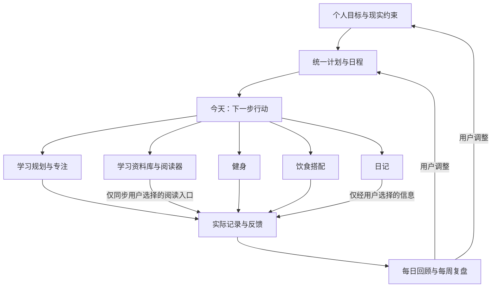

# 大学生个人成长 App：产品架构 v0.2（学习页修订）

日期：2026-09-20
阶段：功能开发中；核心本地数据、任务提醒与坚果云完整备份/恢复已经接通。
已确认：先满足本人和身边大学生；产品形态为独立 Android App；学习页定位为本地 Markdown 查看器。

> **实现现状与本文档的口径差异（更新至 2026-09-20）**
>
> 第 3 节规划的五个底部入口，原型阶段先落地为四个 Tab：**本日计划 / 日记随想 / 学习 / 统计**。
> 差异点：「今天」暂名为「本日计划」；「我的」尚未建立入口，模块开关仍后置；任务提醒已经接入，
> 坚果云备份与恢复暂时从“本日”页进入；
> 原「健康」一级入口在原型阶段被**统计**页取代（健身与饮食搭配的设计目标仍见第 5、6 节，未作废，
> 但暂未实现界面）。「统计」固定放在最后一个 Tab：它是回顾性页面，不适合插在三个日常入口中间。
> 视觉风格改为参考 Typora 的 Claude Desktop 主题（明暗两套），详见第 16 节。
> 数据方面：**打卡、每日计划、日记、卡册、学习资料和主题均已接入真实持久化**（Preferences DataStore
> 与应用私有文件），首页任务支持新增、编辑、删除与勾选，日记支持本地增删改与分类筛选，学习资料支持
> 导入副本、离线阅读和阅读进度，统计页读取真实记录。首页天气与定位已经移除；当前网络只用于把完整
> `.xlbak` 通过 HTTPS WebDAV 上传到用户自己的坚果云。
>
> 本轮界面更正见第 16 节；与前面章节冲突时以第 16 节为准。

## 1. 产品定位与架构结论

**一个围绕大学生日常安排，把学习、运动、饮食选择和生活记录连接起来的个人管理工具。**

用户每天打开它，应该能够快速回答：今天最值得做什么、现在能做什么、这一餐怎么选、今天实际过得怎么样。

建议以“今天”为共同入口，以“学习”和“健康”承载专业功能，以“日记”完成主观记录；由同一套目标、日程、提醒和复盘能力连接各分区。各分区可以单独使用，也可以组合使用。

首版的差异化假设是：**把课表、可支配时间、食堂预算和个人状态带入同一天的安排，减少重复录入与临时决策。** 这是需要通过试用验证的产品假设，并非已证实的市场空白。

### 1.1 首批用户与关键场景

| 场景 | 用户真正要解决的问题 | 产品交付的结果 |
|---|---|---|
| 上课前或课间 | 时间零碎，不知道先处理什么 | 看见下一件可执行的小任务，直接开始 |
| 课间或离开电脑后复习资料 | 学习内容保存在电脑的 Typora 中，手机上查看不方便 | 把 HTML / Markdown 及配图带到手机，在 App 内继续阅读 |
| 宿舍或学校健身房训练 | 不知道今天练什么，器械和时间有约束 | 有可修改的训练安排，能记录实际完成情况 |
| 食堂、外卖、便利店就餐 | 预算有限，想搭配合理，但不做饭 | 从能买到的食物中选组合，缺货能替换 |
| 作业、考试、社团叠在一起 | 计划过满，临时变化后难以继续 | 看见冲突，修改本次安排，保留未完成事项 |
| 睡前 | 想写日记，但长篇记录负担大 | 可以一句话记录，也可以完整书写 |

### 1.2 设计原则

1. 每个分区都要具备“选择目标或内容 → 执行 → 记录 → 调整”的完整流程。
2. 首页聚合下一步行动；专业数据在各自分区内展开。
3. 学习资料页只负责文件导入、阅读与续读；课程任务、课表和专注仍由计划能力负责，不在两个入口重复维护。
4. 日程可以留白，任务可以缩小，计划允许暂停和改期。
5. 饮食以实际可购买的搭配为中心；允许只做结构记录，不强制数热量。
6. 日记正文与情绪记录由用户控制，默认不进入跨模块推荐。
7. 所有模块可关闭；关闭后隐藏入口和提醒，保留历史数据。

## 2. 调研依据：专业 App 的做法如何转化为设计

调研方式：查看官方产品页与帮助文档，共选取 10 个代表产品。以下“已核验做法”为公开资料描述；“本项目取舍”为针对你的使用场景提出的设计判断。未进行全部产品的安装实测、付费功能测试或用户访谈，也不将官网宣传视为效果证据。功能可能因平台、地区及订阅等级而不同。

| 分区 | 代表产品 | 已核验做法 | 本项目吸收什么 | 首版取舍 |
|---|---|---|---|---|
| 健身 | Keep | 提供运动课程、跟练和运动记录。[官方产品页](https://www.gotokeep.com/) | 降低“开始一次训练”的门槛，训练过程有指引 | 小规模训练模板与动作说明即可，大型课程库后置 |
| 健身 | Fitbod | 依据目标、器械、时间和训练历史安排训练，记录组数、次数和重量。[入门指南](https://fitbod.me/blog/2017-12-8-fitbod-getting-started-guide/) | 输入现实约束；保留上次训练表现；允许替换动作 | 首版以模板和用户修改为主，个性化推荐后置 |
| 饮食 | 薄荷健康 | 食物营养查询、饮食记录、餐食识别与健康管理工具。[官方产品页](https://boohee.com/) | 常见食物、份量、记录和回顾组成基础能力 | 先做本校常吃组合，不追求全量食物数据库 |
| 饮食 | MyFitnessPal | Meal Scan 给出食物候选，用户可以调整份量并确认记录。[官方帮助](https://support.myfitnesspal.com/hc/en-us/articles/360045761612-Meal-Scan-FAQ) | 识别或推荐后仍保留选择、修正、确认的步骤 | 拍照识别后置；先优化收藏、复制上一餐与手动组合 |
| 学习资料 | Typora | Markdown 支持标题、列表、任务列表、代码块、表格、脚注、目录、数学公式、图表和内嵌 HTML；图片可使用相对路径 | 以现有 Typora 文件为兼容基线，保留正文层级、代码与配图 | 首版做只读 HTML / Markdown 查看器，不做背单词、笔记编辑或知识库 |
| 学习规划 | TickTick / 滴答清单 | 任务、重复提醒、日历、专注计时和习惯统计相结合。[功能页](https://ticktick.com/features) | 任务和日历使用同一套数据；专注记录关联任务 | 首版保留清单与周视图，复杂看板和协作后置 |
| 学习规划 | MyStudyLife | 以课程、课表、作业、考试和复习组织学生日程，支持轮换课表。[官方产品页](https://mystudylife.com/) | 学期、课程、截止时间与上课占用共同约束安排 | 首版手动建立课表及单双周规则，识别导入后置 |
| 日记 | Day One | 支持日记模板；提供端到端加密的同步能力。[模板帮助](https://dayoneapp.com/guides/tips-and-tutorials/templates/)；[加密说明](https://dayoneapp.com/guides/day-one-sync/end-to-end-encryption-faq/) | 降低起笔难度，明确私人记录的保护边界 | 先做本地记录、模板、锁定与备份；云同步单独设计 |
| 日记 | Daylio | 用心情和活动快速记一条，再提供日历与统计，也允许补充文字。[官方产品页](https://daylio.net/) | 一句话或少量点选也能完成日记；自由写作可展开 | 首版轻记录加长文编辑，复杂相关性分析后置 |

与 Android 相关的核验边界：Day One 官方文档区分了 Android 的手动模板使用与其他平台的默认模板设置；MyFitnessPal 的 Meal Scan 存在平台、语言、版本与订阅限制。本文借鉴流程，不把所有跨平台功能视为 Android 上完全一致。

### 2.1 从调研得到的四个产品判断

- **专业性主要来自正确承载原始内容和记录结构。** 训练需要组数等信息；学习资料需要尽量忠实地显示 Typora 文档及其资源；学习规划需要截止日期与实际产出。只有统一打卡，无法支撑这些功能。
- **降低记录负担很关键。** 本项目采用继续阅读、上次训练、常吃组合和日记模板减少重复操作；实际节省程度要在原型测试中验证。
- **大学生日程应该是共同约束。** 本项目把课表与固定活动放进同一个时间视图，让学习与训练安排看见彼此。
- **多模块的价值需要通过联动验证。** 首版重点观察是否减少重复记录、是否帮助调整计划，而非仅统计用户打开过多少功能。

## 3. 信息架构：五个底部入口

```text
今天
├─ 今天的重要事项 / 下一步行动
├─ 当天时间线 / 全局周计划
├─ 快速记录：任务、运动、饮食、日记
└─ 晚间回顾 / 每周复盘

学习
├─ 资料库：添加文件、搜索、按 HTML / Markdown 筛选
├─ 继续阅读：最近文档、阅读位置、导入版本
└─ 文档阅读器：正文、目录、文内查找、阅读设置

健康
├─ 健身：训练计划、动作、训练过程、历史表现
└─ 饮食搭配：选餐、常吃组合、饮食记录、回顾

日记
├─ 快速记录 / 自由书写
├─ 模板 / 可选活动引用
└─ 时间线 / 日历 / 搜索

我的
├─ 目标与偏好 / 模块开关
├─ 提醒与安静时段
├─ 数据导入导出 / 备份恢复
└─ 隐私设置 / 本地资料
```

学习资料页不维护课程任务。课程、作业、考试与专注统一放在“今天 / 全局周计划”中；学习资料可以被任务引用，但文件本身不因此变成一条任务，也不维护第二份计划。

### 3.1 模块与共享能力



以上是主要使用流程。各模块同时保留直接使用入口：不必建立目标或计划，也可以打开一份学习资料、记录一顿饭、一次训练或一篇日记。阅读文档只更新该文档的续读位置，不自动产生“已学习”记录。

## 4. 今天：全产品的日常入口

### 4.1 首页顺序

1. 日期与接下来的一项固定安排。
2. 用户选定的今日重点，建议最多突出三件；其他任务仍可展开。
3. 下一步行动：显示任务、预计时长、主要按钮。
4. 当天时间线：课表、学习时间块、训练等已排事项。
5. 按需要显示的快捷入口，例如“选午餐”“继续训练”“写一句日记”。
6. 晚间回顾入口，汇总实际发生的记录与尚未处理的安排。

首页首屏回答“现在做什么”，完整报表放入复盘。首页不要求每天完成所有分区，也不把饮食、心情、学习混成一个总分。

### 4.2 行动排序

- 用户置顶的事项优先保留。
- 已开始但未结束的训练或专注，显示“继续”。
- 临近的固定安排与截止事项需要明确可见。
- 可自由安排的事项显示预计时长，帮助用户判断当前空档能否完成。
- 最近阅读资料保留在学习页；只有用户明确把资料关联到计划任务时，今天页才显示相应打开入口。
- 无足够时间时给出“缩小本次 / 改期 / 暂不安排”，不偷偷移动固定课程。

首版采用可解释的排序和人工调整。自动排程属于后续增强。

### 4.3 首页示意内容

以下内容为设计示例，并非真实用户记录或训练建议。

```text
周一 · 下午有两节课

今日重点
□ 完成高数第三章错题整理    40 分钟   开始专注
□ 阅读网络基础笔记          30 分钟   打开资料
□ 晚间训练                 30 分钟   查看安排

接下来
14:00—15:35  大学物理
16:00—16:40  高数错题整理

快捷入口
继续阅读 · 选一餐 · 记运动 · 写日记
```

## 5. 健身分区：把一次训练做完整

### 5.1 核心问题

“在今天可用的时间、场地和器械条件下，我做什么、怎么记录、下次如何接着练？”

参考 Keep 的跟练入口与 Fitbod 的条件输入、训练日志；本项目采用以下结构。

### 5.2 关键页面与操作

| 页面 | 主要内容 | 主要操作 |
|---|---|---|
| 健身概览 | 本周安排、下一次训练、最近记录 | 开始训练、调整本次 |
| 训练计划 | 目标、场地、器械、频次、可用时间 | 选模板、自建计划、排入日程 |
| 训练详情 | 动作顺序、组次、上次记录、说明 | 替换动作、修改组次、开始 |
| 训练中 | 当前动作、组数/次数/重量或时长、休息计时 | 记一组、跳过、暂停、结束 |
| 训练总结与历史 | 实际完成、总时长、主观难度、备注 | 保存、回看、复制安排 |

同一记录结构需要兼容不同活动：力量训练记录组次与重量；跑步或其他活动可手动记录时长、距离等相关字段。字段按活动类型显示。

### 5.3 关键规则

- 首次只收集目标、经验、器械、每周频次和可用时间等必要信息；不因未填写体重阻止训练记录。
- 模板只是起点，动作可以因器械不可用或个人偏好替换。
- 实际完成与计划分开保存。提前结束也能保存，不要求虚构完整完成。
- 下次优先展示上次数据，由用户确认是否调整；首版不自动加重量。
- 记录“不适”时提供结束和调整入口，不以奖励机制鼓励硬撑。
- 训练日程结束不会自动产生训练记录；用户勾选完成但未录详细数据时，明确标记为手动确认。

### 5.4 第一版边界

包含训练模板、自建动作、过程记录、计时、历史与日程联动。训练内容来自自编并审核的素材或可使用的授权内容。先做到少量模板可稳定使用；视频课程社区、动作摄像识别、可穿戴设备连接后置。

**验收场景：** 用户从今天进入训练，临时替换一个动作，完成部分组数后提前结束；实际记录与当天日程一致，下一次能看到上次数据。

## 6. 饮食分区：围绕“这一餐怎么搭配”设计

### 6.1 核心问题

“我现在去食堂、点外卖或逛便利店，在预算和偏好内，应该选择哪几样，买不到时怎么替换？”

这个分区同时支持餐前选择与餐后记录。首页首先提供“搭配一餐”，其次是“记录刚才吃的”。

### 6.2 输入与输出

| 输入 | 必要程度 | 用途 |
|---|---|---|
| 用餐场景：食堂 / 外卖 / 便利店 | 每次可切换 | 决定候选范围 |
| 本餐预算 | 可选，可记住上次值 | 筛选组合与替换项 |
| 忌口、过敏项、素食偏好 | 按需设置 | 排除不适合的候选项；不确定时明确标记 |
| 能买到的食物或常吃菜单 | 首次逐步建立 | 避免推荐实际买不到的组合 |
| 搭配目标：日常均衡等 | 可选 | 决定展示侧重点 |
| 本餐实际选择与份量 | 记录时填写 | 保存常吃组合与回顾 |

输出每次控制在少量可比较的组合：食物名称、食物类别、可选份量、价格信息、简短搭配理由、可替换项，以及“我就吃这个 / 修改后记录”。

价格只来自用户输入或明确的数据来源；缺失则显示“价格待填”。供应情况也是用户维护的信息，首版不声称接入了食堂实时库存。

### 6.3 两种记录深度

- **轻记录模式，默认：** 记录食物组合与大致份量，回顾出现过哪些食物类别；不要求每样称重。
- **营养详情模式，按需：** 在有可信营养数据和份量输入时展示估算及来源，允许更正；数据不足就不显示伪精确的热量与营养素数值。

默认模式不强制减重目标，也不把一餐简单评为“好”或“坏”。食物分类和搭配模板属于待审核内容；具体营养目标需在内容设计阶段建立可靠依据，本架构不预设个体摄入处方。

### 6.4 页面结构

1. **选餐页：** 场景、预算、当前候选食物和常吃组合。
2. **组合详情页：** 每一项可替换，价格与已知信息同步变化。
3. **记一餐页：** 收藏、最近、复制上一餐、手动添加。
4. **饮食回顾页：** 按餐次与日期查看记录；支持补记，明确记录覆盖情况。

设计示例：“某食堂的米饭 + 豆腐菜 + 青菜”可保存为常吃组合；用户把其中一项换成当日供应的其他食物，再确认实际份量和价格。这是组合交互示例，不是针对个人的营养推荐。

### 6.5 核心规则与首版边界

- 收藏的组合是模板；实际一餐的份量与价格独立保存，修改收藏不改变历史。
- 推荐后必须确认实际吃了什么；看过组合不算完成饮食记录。
- 一天未记全时显示“仅基于已记录餐次”，不据此判断营养缺口。
- 健身安排可以提供用餐场景标签，但不能把估算运动消耗自动换成精确加餐额度。
- 首版先维护本人和同学常吃的有限菜单；餐食图像识别、外卖平台接口、全量营养库后置。
- 原始食物数据、份量单位与来源要预留。采集到的真实数据规模取决于试用，不人为承诺“覆盖全部食堂”。

**验收场景：** 用户设置本餐预算，在已维护菜单中选一套组合，替换缺货项，确认份量并保存；下次能快速复用，历史价格不被新价格覆盖。

## 7. 学习资料分区：本地 HTML / Markdown 查看器

### 7.1 定位与边界

学习页解决的问题是：“我已经在电脑的 Typora 中写好了资料，怎样把它带到手机，并尽量按原来的结构继续阅读？”

这个分区是**只读资料库与阅读器**，不是背单词工具、Markdown 编辑器、课程任务清单或自动整理知识库。用户在电脑上继续使用 Typora 维护原文件；手机端添加一个可离线阅读的导入快照。课程、作业、考试和专注仍归“本日计划”，必要时只保存到资料的引用。

### 7.2 页面与核心流程

```text
电脑 Typora 编写
└─ 转移 .md / .html 与配套 assets 到手机
   └─ 学习页“添加”
      ├─ 选择单个或多个文件
      └─ 选择资料文件夹 / 压缩包（用于保留相对资源）
         ↓
      校验格式与资源 → 创建本地只读快照 → 加入资料库
         ↓
      搜索 / 格式筛选 → 在学习页内打开阅读器 → 保存续读位置
```

学习资料首页由以下区域组成：

1. 标题与“添加”主入口。
2. 按标题、文件夹或正文查找的搜索入口。
3. “继续阅读”卡片，显示最近文档、上次位置和阅读进度。
4. “全部 / Markdown / HTML”筛选与文件列表；列表显示标题、来源文件夹、格式、大小和更新时间。
5. 空资料库引导，说明可以添加 Typora Markdown、导出 HTML 或含图片的整个资料文件夹。
6. 阅读器顶部栏，提供返回、文内查找、阅读进度和更多阅读设置；正文留给后续渲染层承载，不跳到外部浏览器。

### 7.3 Typora 兼容基线

2026-09-14 已核验本机 Typora 自带的 `Markdown Reference.md`、`Use Images in Typora.md`，并抽查 `F:\Basic knowledge` 下的实际 `.md` / `.html` 样本。用户最初给出的 `F:\Typora\维护文档` 精确路径当前不存在，因此以下契约是可执行的暂定基线；进入渲染实现前仍需用修正后的维护文档目录做一轮回归样本确认。

| 级别 | 内容 | 兼容要求 |
|---|---|---|
| P0 必须 | UTF-8 中文、标题、段落、粗体/斜体/删除线、列表、引用、分隔线、链接 | 保持层级、换行和基本语义，长内容可流畅滚动 |
| P0 必须 | 围栏代码块及语言标记、行内代码、Markdown 表格 | 使用等宽字体；代码和宽表允许横向滚动，不挤坏整页 |
| P0 必须 | ``、原始 ``、`assets/...`、`../...` 等相对图片路径 | 相对当前文档或导入根目录解析；缺图显示占位与原路径，不让整篇文档失败 |
| P0 必须 | Typora `==高亮==`，以及相邻的 `typora-color-v1`、`typora-annotation-v1` HTML 注释 | 至少保留高亮文本；颜色与批注元数据无法完整呈现时安全降级，不能把注释正文直接显示给读者 |
| P0 必须 | Typora 导出 HTML 的标题、正文、锚点、内联样式、代码、表格和本地图片/CSS | 在 App 内只读显示；优先还原内容与排版，不要求逐像素复制桌面主题 |
| P1 增强 | YAML Front Matter、`[TOC]`、脚注、任务列表、上下标、下划线 | Front Matter 默认折叠；目录与脚注可跳转；任务列表只读 |
| P1 增强 | 行内/块级 LaTeX、Mermaid/流程图、音视频标签、Typora 自定义主题字体 | 使用 App 内受控依赖渲染；资源不可用时显示源码或明确占位，不执行文档自带脚本 |

`typora-root-url` 需要被识别，但只能映射到用户本次导入的资料根目录；不能据此读取 App 资料区之外的任意路径。Windows 绝对路径和 `file:///` 引用在手机上无法原样成立，导入时应提示用户同时选择资源目录并建立受限映射。

### 7.4 导入、版本与安全设计

- 支持的入口规划为 `.md`、`.markdown`、`.html`、`.htm`，以及包含这些文件和配套资源的文件夹或压缩包。仅选择一个 Markdown 文件时，如果检测到相对资源，导入确认页要提示继续选择其根目录。
- 使用 Android 系统文件选择器获取用户明确选择的内容。导入后复制为 App 私有目录中的只读快照，并保存来源名称、原修改时间、导入时间、文件大小、内容哈希与导入版本；App 不反向修改电脑原稿或手机上的源文件。
- 同名不代表同一文档。默认按来源标识与内容哈希识别重复项；重新导入可选择“替换为新版本”或“保留副本”，替换时保留可映射的阅读位置。
- Markdown 由本地解析器转换到 App 控制的阅读模板；HTML 在受限容器中显示。文档自带 JavaScript 默认禁用，不开放任意 `file://` 访问，不允许跨文档读取本地文件。
- 外部网页链接交给用户确认后打开；远程图片、字体和样式默认不作为离线保证，可提供“加载外部资源”的单次选择。任何远程资源失败都不能阻止本地正文阅读。
- 导入失败必须指出具体文件与原因；部分资源缺失时允许打开正文，并给出可查看的资源问题清单。

### 7.5 阅读状态与首版边界

每份资料独立保存最近阅读时间、滚动位置、最近标题锚点和粗略进度。进度只用于“继续阅读”，不等同于掌握程度、任务完成或学习时长；文档版本变化导致锚点失效时，优先回到最近仍存在的标题，否则回到文首并说明原因。

P0 计划交付：添加文件/资料包、资料库、格式筛选、标题搜索、Markdown 与静态 HTML 阅读、相对图片、代码与表格、续读位置、删除导入副本。正文全文搜索、目录、主题/字号、批注、收藏和重新导入版本对比可在 P1 增强；编辑、双向同步和自动知识抽取不在当前范围。

**当前实现状态：** 已完成资料库、继续阅读、筛选、搜索、文件导入、导入副本持久化、Markdown / 静态 HTML 渲染、受限本地资源加载、实际页面跳转、删除副本和阅读位置记录。导入支持单个或多个 Markdown / HTML 文件、ZIP 资料包及资料文件夹，并对重复内容、路径穿越、文件数量与总大小做校验。

**后续验收场景：** 用户把一份 `.md`、一份 Typora 导出的 `.html` 和各自的 `assets` 目录转移到手机，添加后能在资料库中筛选并打开；中文、代码、表格、高亮与相对图片可读；退出再进回到上次位置；缺一张图片时正文仍可打开并明确提示。

## 8. 学习安排：归属于“本日计划”而非学习资料页

本节保留课程、任务与专注能力，但它们不再占用学习资料页的信息层级。它们从“本日计划 / 全局周计划”进入；任务可以附加一个 `StudyDocument` 引用，让用户从计划直接打开相关资料，阅读行为不会自动勾选任务。

### 8.1 层级结构

```text
学期
└─ 课程 / 考试 / 项目
   └─ 目标或交付物
      └─ 任务
         └─ 一次或多次实际学习时段
```

任务可以直接创建，不强制先建完整层级。例：“周五提交报告”可以先是一条任务，之后再关联课程。

### 8.2 三种时间必须区分

| 类型 | 含义 | 例子 | 排程规则 |
|---|---|---|---|
| 固定日程 | 在确定时间发生的安排 | 课程、考试、已约好的活动 | 标明占用，不被自动挪动 |
| 截止时间 | 最晚应交付的时刻 | 周五 18:00 交报告 | 始终保留，改学习安排不改截止时间 |
| 计划执行时间 | 准备实际投入的时段 | 周三 16:00 写报告 | 允许用户移动、拆分与取消 |

### 8.3 核心流程

1. 建立本学期课表；支持每周、单双周和日期例外。
2. 添加考试、作业或个人学习目标，填写截止时间与可选的预估投入。
3. 拆成有实际产出的任务，例如“完成第三章 10 道题并订正”。
4. 在周视图中选择时间块，若冲突则给出提示。
5. 开始专注，可使用倒计时或正计时；允许暂停。
6. 结束后填写完成了什么，选择完成、部分完成或继续安排。
7. 周复盘结合完成情况与时间估计调整下一周。

### 8.4 必须保持的规则

- 计时结束只产生专注记录，不自动代表学习任务完成；用户确认实际产出。
- 未完成任务保留原截止时间与修改记录，改期不会掩盖已经逾期。
- 调整重复安排时提供“仅本次 / 后续安排”，不影响已完成历史。
- 空闲时间不全部填满；用户可预留用餐、通勤、休息等时间。
- 训练已计入当天安排时，不再额外复制成另一条同义任务；打开或读完资料也不自动创建学习任务。
- 首版计划拆分由用户或固定模板完成；自动生成拆分与排程后续再验证。

### 8.5 首版边界

手动课表、课程与任务、截止日期、任务拆分、周计划、专注记录、改期仍是计划能力的基础。教务网站适配、课表截图识别和团队项目协作后置；学习资料查看器按第 7 节独立实施，不演变为笔记知识库。

**验收场景：** 用户在已有课程的周视图中安排作业；发生冲突可以改期；一次专注结束但作业未完成时，保存实际时长并继续保留任务。

## 9. 日记分区：轻记录与自由表达并存

### 9.1 两个入口

- **快速记录：** 可选心情、活动标签和一句话；无需凑齐所有字段。
- **自由书写：** 标题、正文与可选标签；支持保存草稿和按日期回看。

首版提供少量可编辑模板，例如“今天发生了什么 / 我的感受 / 明天想调整什么”。模板是写作帮助，不强制填写；也不把每篇日记都变成效率复盘。

### 9.2 与其他分区的联动

打开“插入今日记录”，用户可以选择加入已完成学习、训练或其他事件。加入后形成当时的引用快照，用户可以编辑；之后修改源记录时提示来源变动，不静默重写日记。

日记不自动生成用户未表达的感受。心情记录缺失时保持为空，不能根据任务完成数推断。

### 9.3 私密性与长期可用性

- 草稿及时保存，异常退出后可以恢复。
- 日记支持单独锁定；锁屏提醒只显示中性提示。
- 日记正文默认不参与跨模块统计、推荐或模型处理。
- 本地访问保护、设备内数据保护、备份保护分别设计；界面锁不等于数据加密。
- 支持导出与恢复。普通文本导出和加密备份应明确区分，备份密码或密钥的恢复规则也需要说明。
- 如未来加入云同步，需先决定加密与密钥恢复方案，再承诺隐私能力。

### 9.4 首版边界

快速记录、长文、模板、草稿、日历、搜索、锁定和备份。照片附件可以随后加入；语音转写、公开社区、自动心理解释与情绪因果分析后置。

**验收场景：** 用户写一半退出，再进入仍能继续；可以只写一句话，或选择插入一条训练记录；其他分区不会自动读取日记正文。

## 10. 模块联动与共同规则

### 10.1 需要优先实现的联动

| 触发 | 系统更新 | 用户能得到的结果 | 边界 |
|---|---|---|---|
| 建立学习任务或训练安排 | 在同一日程上显示 | 看见一天的总体负担 | 保留各分区专业数据 |
| 添加或重新导入学习资料 | 更新资料库、资源校验与可搜索元数据 | 在手机上读到电脑维护的最新快照 | 不反向修改源文件，不把导入视为学习记录 |
| 打开或退出一份学习资料 | 更新最近阅读与续读位置 | 下次从接近上次的位置继续 | 不自动完成任务，不推断掌握程度 |
| 保存训练 | 更新对应计划执行状态与历史 | 记录一次即可 | 部分完成也有明确状态 |
| 结束专注 | 保存时长并询问任务产出 | 看见投入与产出的区别 | 不自动勾完成作业 |
| 确认一餐 | 保存实际组合与份量 | 方便复用和回顾 | 收藏或浏览不算吃过 |
| 手动改一天的安排 | 显示冲突和待重新安排事项 | 临时变化后还能继续 | 首版由用户选择调整 |
| 写日记时选择今日事件 | 插入用户选定的记录 | 减少重复书写 | 默认不读取正文用于推荐 |
| 打开每周复盘 | 汇总实际记录、未完成和覆盖情况 | 决定下一周保留或调整什么 | 缺少记录不判定为行为缺失 |

### 10.2 统一状态

计划事项至少区分：待开始、进行中、部分完成、已完成、已跳过、已取消。改期是日程变更，保留变更历史；无需将所有业务状态压成同一个打卡布尔值。

> 原型阶段的落地口径：**取消了「部分完成」这一档**，计划事项只有待开始 / 进行中 / 已完成。
> 勾选是唯一的完成操作，状态标签不再做成可点的操作。理由见第 16.6 节。
> 上表仍是长期目标；恢复该档位时按第 16.6 节的反向操作处理即可。

训练、计划和饮食的细节仍由各自模块维护。学习资料采用“可用 / 资源缺失 / 导入失败”等文件状态和独立阅读状态，不套用任务的完成状态；首页汇总也不能替代详细记录。

手动点击完成要明确记录来源；撤销时提示将影响对应日程或实际记录。删除计划不连带删除过去的训练、饮食或学习历史。

### 10.3 提醒

全局设置安静时段、模块开关和提醒偏好；课程、考试、截止事项与日常建议分开配置。相近的一般提醒可以合并，正在训练或专注时避免弹出无关建议。不能因为未连续使用而逐级增加催促频率。

通知权限拒绝后仍可在 App 内看到日程；首版必须在实际使用的 Android 设备上验证后台提醒行为，不能承诺任何系统状态下都绝不延迟。

> 原型阶段的落地口径：**已落地一次性提醒**——首页时间区域进日历页自行安排，
> 任务也可以设预期开始时间；到点弹一次通知，弹后留在通知栏等用户手动划掉。
> 重复提醒、提前提醒、安静时段与模块开关仍未实现，口径见第 16.12 节。

### 10.4 恢复与低负担使用

几天没用后，给出仍需处理的事项、最近阅读资料和修改本周目标的入口。恢复使用时允许先处理一件事；历史不会因断签清零，资料续读位置也不会因长期未打开而重置。

## 11. 逻辑架构与数据归属

本节界定产品需要保存什么以及谁负责它，暂不锁定技术栈或数据库实现。

### 11.1 共享能力

- 用户资料与偏好：模块开关、时间与预算偏好、隐私选择。
- 目标与日程：目标、任务、固定活动、重复规则、日期例外、提醒。
- 记录索引：聚合记录的类型、时间、来源和关联事项，服务首页时间线。
- 每日/每周复盘：读取允许汇总的记录，生成可追溯的视图。
- 数据管理：导入、导出、备份、恢复和删除；学习资料导入还要维护文档与配套资源的边界。

### 11.2 核心对象

| 对象 | 关键内容 | 主要归属 |
|---|---|---|
| Profile / Preference | 用户资料、偏好、模块开关 | 公共 |
| Goal | 目标、周期、衡量方式、状态 | 公共；可被模块关联 |
| Task | 事项、预估投入、截止时间、来源类型 | 计划 |
| ScheduleOccurrence | 某一次实际安排、起止时间、重复来源、例外状态 | 日程 |
| FocusSession | 实际专注时段、暂停、关联任务、产出反馈 | 学习规划 |
| Course / Term / Exam | 学期、课程、课表规则、考试安排 | 学习规划 |
| StudyDocument | 展示标题、格式、导入快照、来源元数据、内容哈希、导入版本 | 学习资料 |
| StudyAsset | 所属文档、受限相对路径、媒体类型、大小、校验状态 | 学习资料 |
| ReadingState | 文档版本、最近时间、滚动位置、标题锚点、粗略进度 | 学习资料 |
| WorkoutPlan / WorkoutSession | 计划模板与实际训练 | 健身 |
| Exercise / SetLog | 动作定义和逐组记录 | 健身 |
| FoodItem / MealTemplate / MealLog | 食物来源、收藏组合、实际餐食与份量 | 饮食 |
| JournalEntry | 正文、日期、可选心情、标签、事件引用 | 日记 |
| ActivityIndex | 来源记录标识、类型、时间、允许展示的摘要 | 公共派生索引 |
| WeeklyReview | 指标快照、用户复盘、用户选定的下一步 | 复盘 |

关系原则：一个目标可关联多个任务；一个任务可有多个安排和执行记录，也可选关联一份 `StudyDocument`。文档拥有一组受限资源和按导入版本保存的阅读状态；重新导入产生新版本或副本，不静默覆盖来源不明的同名文件。一条实际记录仍可不属于任何计划。

### 11.3 数据一致性

1. 各模块的实际记录是事实来源；今日进度与复盘是其派生展示。
2. 同一记录用稳定标识关联，避免保存后又创建一份独立打卡记录。
3. 内容模板与使用时的实际记录分离；更新模板不修改历史。
4. 保存实际发生时间与所属日期；跨午夜记录允许用户明确归属，避免一天被重复计算。
5. 修改、删除或恢复记录后，关联统计应可重新计算。
6. 日记正文不进入公共索引；索引只保存用户允许展示的必要信息。
7. 关闭模块与删除模块数据是两个不同操作。
8. 学习资料索引是导入快照的派生数据；重新导入、删除或恢复后可重建，不能成为正文的唯一副本。
9. 删除导入副本只删除 App 管理的文档、资源与阅读状态，不删除系统文件选择器中的源文件；执行前明确说明影响范围。

### 11.4 首版部署思路

首版采用单一 Android 应用、内部按业务模块组织，核心流程优先本地可用。训练、饮食、任务、学习资料和日记记录不依赖在线模型；已导入的 HTML / Markdown 与本地资源可离线阅读。

先做好本地保存、备份恢复和可替换的内容来源。账号、云同步和多设备冲突处理是后续独立能力。此阶段无需拆成多个服务，也无需让全部功能通过一个聊天界面操作。

## 12. 首版范围与迭代顺序

P0 指首个可持续自用版本；P1 指经过试用后增强；P2 指有明确需求和资源后再考虑。下面是建议排序，并非开发工期承诺。

| 能力 | P0：可持续自用 | P1：试用后增强 | P2：条件成熟后 |
|---|---|---|---|
| 今天与公共能力 | 今日清单、下一步、周视图、模块开关、提醒、备份恢复 | 可配置快捷入口、Android 桌面组件、更多复盘 | 多设备同步与复杂自动排程 |
| 学习规划 | 手动课表/单双周、任务、截止日期、专注、改期 | 课表导入、学习计划辅助拆分 | 多校教务适配、团队协作 |
| 学习资料 | 添加 Markdown / 静态 HTML、配套资源、资料库、基础搜索、只读阅读、续读 | 全文搜索、目录、公式/图表增强、阅读设置、版本对比 | 编辑、双向同步、自动知识抽取 |
| 健身 | 小量模板、自建动作、组次或时长记录、计时、历史 | 根据历史提出可解释的调整建议、更多内容 | 动作识别、设备连接、大型课程库 |
| 饮食 | 本校常吃菜单、预算筛选、组合替换、确认记录、收藏 | 经核验的营养数据、覆盖更多真实场景 | 餐食识别、平台或食堂接口 |
| 日记 | 快速/长文、模板、草稿、搜索、日历、锁定 | 照片、更多导出、可选事件回顾 | 云同步、可选语音转写 |

### 12.1 实施分段

**第一段：验证计划与记录骨架。** 先串通今天、手动课表、任务、专注、基础日记和数据保存。这一段验证的是日常入口，不代表五个分区已经交付。

**第二段：接入三个专业流程。** 先接学习资料导入与阅读，再接健身过程记录与饮食组合。每接入一个模块，就验证一次从入口进入、完成核心操作后返回的完整流程；阅读资料不自动更新任务完成状态。

**第三段：形成 P0 试用版。** 补齐五个分区的中断恢复、提醒、隐私控制、备份恢复和周复盘，让本人和同学进行连续试用。

**第四段：以试用决定 P1。** 根据哪里最常用、哪里最难记录、哪些联动实际有用来安排增强，不按“功能看起来高级”决定顺序。

如果资源不足，先减少内容规模和自动化程度，保留五个分区各自能完成一次真实使用的流程。

### 12.2 首轮交互设计页面清单

建议按以下页面族绘制原型，页面族中的部分步骤可以用弹层或同页状态承载。

| 编号 | 页面族 | 需要覆盖的状态 |
|---|---|---|
| 01 | 初次设置 | 选择模块、跳过资料、首次进入 |
| 02 | 今天 | 空状态、有计划、进行中、未完成 |
| 03 | 全局周计划 | 课程占用、时间冲突、改本次/后续 |
| 04 | 学习资料库 | 空状态、添加入口、继续阅读、HTML / Markdown 筛选 |
| 05 | 添加学习资料 | 单文件、多选、文件夹/压缩包、重复文件、导入确认 |
| 06 | 文档阅读器 | Markdown、HTML、相对图片、长代码/宽表、文内查找、续读位置 |
| 07 | 导入结果与资源问题 | 成功、格式不支持、部分缺图、编码异常、重试 |
| 08 | 任务编辑与详情 | 截止时间、拆分、排期、关联资料、完成/部分完成 |
| 09 | 专注 | 进行、暂停、恢复、结束反馈 |
| 10 | 健康概览 | 训练入口、选餐入口、最近记录 |
| 11 | 健身计划与详情 | 模板、自建、替换、安排日期 |
| 12 | 训练中与总结 | 记组、暂停、提前结束、保存 |
| 13 | 选餐与组合详情 | 预算、偏好、无匹配、缺货替换 |
| 14 | 记一餐与回顾 | 常吃、复制、修改、信息不全 |
| 15 | 日记列表与日历 | 空状态、搜索、已锁定 |
| 16 | 日记编辑 | 快速记录、长文、草稿恢复、引用事件 |
| 17 | 每周复盘 | 数据充足、记录不足、修改下周目标 |
| 18 | 我的与数据管理 | 开关模块、提醒、导出、备份恢复 |

## 13. 内容工作与 AI 的边界

产品是否可用取决于真实内容。首版至少需要准备：一组经用户授权的 Typora Markdown / HTML 回归样本及配套资源、可以说明动作的训练素材、实际常吃的菜单或组合，以及少量原创日记和规划模板。

为每类内容保存来源、使用条件、更新时间和维护方式。学习资料默认来自用户主动选择的本地文件，App 只维护导入副本；竞品的课程视频、图片或食物数据库不能默认成为本项目的内容来源。

AI 可在 P1 辅助把目标拆成任务、把自然语言转成记录草稿，或解释一个已选方案。它输出的安排先供用户修改确认；营养数值需有依据。学习资料正文与日记一样，默认不提供给在线模型，只有用户明确选择某份内容与用途时才可进入后续 AI 流程。

P0 的计划、记录、资料阅读、组合选择和日记编辑均可独立完成。AI 成本、网络故障和输出波动不应阻断这些核心流程。

### 13.1 学习助手：App 直连 DeepSeek（2026-09-20）

> **状态：方案已定，暂不实施（2026-09-20）。** 本节记录的是决策与边界，不是排期中的功能。
> 结论是先不引入 agent：对日常记录与打卡没有实际帮助，真正的流失点是「某天忘了打卡之后再也没
> 打开」，那不是模型能解决的问题。留着这一节是为了将来真要动时不必重新论证一遍；
> 若将来落地，下面的口径与第 13 节的两条硬边界一并生效。
>
> 真要做时，唯一「没有 agent 就做不到」的是**周复盘**（同时读打卡、任务、日记才能说出的关联），
> 且它只读不写库、风险最低，因此应从它开始——而不是从「第 1 步：一句话 → 任务草稿」开始。
> 第 5 节保留原顺序，是因为它示范了最窄的完整闭环；实施顺序以本段为准。

本节把第 13 节那条边界落成可实现的方案。三个已定结论：**无服务端**（App 直接调 DeepSeek
官方接口，没有任何中间层要运维）、**默认联网模型**（不追求端侧推理）、
**用户自带 key**（仓库里不放任何密钥，费用记在用户自己的 DeepSeek 账号上）。

第 13 节的两条硬边界在本节继续有效，且是这一节的判据：**AI 挂了不能拖住 P0 任何流程**；
**日记正文与学习资料正文默认不出本机**。

**1. 接入与凭据**

| 项 | 当前口径 |
|---|---|
| 端点 | `https://api.deepseek.com/chat/completions`，OpenAI 兼容格式 |
| 鉴权 | `Authorization: Bearer <用户自己的 key>`，在设置页填写 |
| 模型 | 默认 `deepseek-flash`；`deepseek-v4-pro` 只在周复盘这类长文任务里作为可选档 |
| 传输 | 复用已有 okhttp，不新增网络库 |

API key **不进 `.xlbak`**（与坚果云凭据同类：属于当前设备）。落盘沿用
`CredentialCipher` 那一套——Android Keystore 持密钥、AES-GCM 密文入 Preferences DataStore，
新功能换一个 `KEY_ALIAS`，不复用 WebDAV 的别名与 AAD。

系统备份（`android:allowBackup="true"`）即便把这段密文带到别的设备也解不开：
Keystore 密钥不可导出，新设备上 `decrypt` 必然失败。**因此换机后需要在设置页重填 key**，
这是预期行为，不是故障。

> 这只说明 Keystore 密文换机后不可用，不代表当前系统备份边界已经安全。
> Manifest 尚未声明 `dataExtractionRules` / `fullBackupContent`，其他 DataStore 仍可能被系统备份或迁移；
> 当前风险与上线前决策见 `README.md`「当前边界」和《坚果云备份与恢复：开发说明》第 6 节。

**2. 发送边界**

| 范围 | 默认 | 说明 |
|---|---|---|
| 任务标题、日期、预期开始时间、完成状态 | 允许 | 排计划的最小必要输入 |
| 打卡状态（是否已打卡、连续天数） | 允许 | 只发状态，不发历史明细 |
| 日记正文 | **禁止** | 用户明确选择某一条并指定用途时才可单独确认后发送 |
| 学习资料正文 | **禁止** | 同上 |
| 备份凭据、卡册明细、延迟统计 | **禁止** | 与需求无关，不参与任何 prompt |

上下文只给未来 7 天到当天，不做全量历史外发；每轮对话独立，不默认携带跨天历史。

**3. Agent 循环的位置**

agent 的读—改—回循环在**本机**，模型只负责产出结构化意图：

1. App 组装上下文（当天/次日的打卡日、任务、时间）
2. 请求 DeepSeek，`response_format: {"type": "json_object"}` 或 `tools`
3. 落点始终是 App 自己的代码，**由它调 Store / Controller 执行**
4. 模型永远拿不到数据层句柄，也不直接写库

写操作一律先给草稿、用户确认后才落库。这条不是保守，是因为三处状态**不可逆**：
当天任务在打卡完成后锁定勾选、计划存档按天固化、抽卡每天只有一次机会。

**换日口径**：计划日期一律用 `currentCheckInDay()` 的 epoch day。系统提示里必须写入
「今天是哪个打卡日、明天是哪个打卡日、现在几点」，否则模型理解的「明天」会和凌晨 6 点换日
差一天，把任务排到错误日期上去——这是本功能最容易埋进去、又最难事后查出来的错误。

**4. 入口与界面**

不新增第五个 Tab（第 3 节的信息架构不动，第 16.5 节也说明 Tab 位置由回顾性决定）。
入口放在**任务弹窗**内（与第 16.12 节一致），学抽卡入口那样贴在已有动作旁边：
用户在加任务的地方说一句话，草稿以卡片形式逐条列出，可改可删，确认后与手动新增
**走同一条写入路径**（含打卡锁判断）。

界面沿用第 16.25 节的口径：不写功能说明句，只留标签与状态。

**5. 第 1 步：一句话 → 任务草稿**

只做这一件事，约 300–400 行，不引入 tool calling、不做多轮、不做流式。

```text
自然语言：「明天上午复习高数两小时」
      ↓  DeepSeek JSON 模式
{
  "tasks": [
    { "date": "2026-09-22", "startTime": "09:00", "title": "复习高数" }
  ]
}
      ↓  确认卡（可逐条改时间 / 改标题 / 删除）
DailyPlanController.addTask(...)  ←  与手动新增同一条路
```

`date` 只接受 `yyyy-MM-dd`，且必须落在允许窗口内（当天起 7 天），超出即拒；
`startTime` 可空（沿用「未设置时间的任务排末尾」的既有口径）；标题为空即拒。
空 `tasks` 数组是合法结果，界面给一句「没听出要加什么任务」，不算失败。

JSON 对象由 App 自己逐字段 parse，**不做多态反序列化**：

- 项目现在全是手写编解码，没有 JSON 库。**用 Android 自带的 `org.json` 即可**，
  不为这一处引入 kotlinx-serialization 与 KSP——收益不抵构建复杂度。
- DeepSeek 官方文档明确提示 JSON 模式**偶发返回空 content**，且 `max_tokens` 给小了
  会在中途截断。所以这四条必须都当正常路径处理：空 content、`JSONException`、
  `date` 超窗、字段缺失。任一条命中都退回到「让用户重说一遍」，而不是让页面停在转圈上。

**6. 第 2 步：只读辅助**

把目标拆成任务、对已过去的一周给一段复盘文字。**产出只显示、可复制，不写库**，
因此不需要确认闸门，是成本最低、风险最小的一段。

**7. 第 3 步：tool calling（条件成熟再做）**

只有在前两步真的被用起来之后才做，且必须补齐：每个工具一张确认卡、
单轮工具调用次数上限（防止模型来回空转烧 token）、
`strict` 模式（需要 `https://api.deepseek.com/beta` 且 `additionalProperties: false`）、
以及调用失败时的补偿路径。

**8. 失败与成本**

错误映射按官方错误码逐条给可执行的话，不出现裸错误码：

| 情况 | 界面说一句话 | 能否自救 |
|---|---|---|
| 无网络 / 超时 | 连不上 DeepSeek，检查网络后重试 | 重试 |
| 401 | API key 无效或已删除 | 跳设置页 |
| 402 | DeepSeek 账号余额不足 | 跳充值页（站外） |
| 429 | 请求太频繁，稍等一下 | 重试 |
| 500 / 503 | 服务端繁忙 | 重试 |
| JSON 空 / 解析失败 | 没听清，再说一遍 | 重发 |

请求超时按一次一请求设置并给取消入口，不自动重试——自动重试在 429 上只会让情况更糟。
单次请求大约千级输入 token、几百输出 token，成本量级可忽略；但第 3 步的多轮循环
会成倍放大，所以它才要单独设上限。

**流式输出第 1 步不做。** 非流式对本功能完全够用；等真实出现「等太久」的体感再加，
那时也只需在 okhttp 响应体上按 SSE 逐行读，不需要换库。

**9. 备份与测试**

- key 不接入 `.xlbak`，因此**不触发第 16.35 节那条持久化门禁**：它是设备凭据，
  与坚果云密码同类，开发说明的排除清单要同步登记一条。
- 端点与模型名是否算可恢复配置，按「丢了重填一次即可」处理，不写进备份。
- 新增单元测试沿现有类别放置：请求体组装与 `date` 窗口校验放 `data/agent/`，
  空 content / 截断 / 畸形 JSON 的降级路径各一条——**这三条是这一功能真正会失败的地方**。

## 14. 如何验证这套架构

### 14.1 先验证问题，再验证功能

建议邀请 5—8 名身边同学进行探索性访谈，覆盖主要住校、使用食堂、存在课程任务与个人目标的人。人数是建议样本规模，不代表统计意义。

访谈围绕最近一周的真实行为：现在如何安排课程与个人活动、最近一次放弃记录是为什么、食堂选餐时考虑什么、在哪些 App 间重复填写了内容。让参与者展示具体流程，避免只问“你会不会用”。

### 14.2 原型测试的五个任务

1. 在已有课表的某天安排作业，发现冲突后调整。
2. 添加一份带 `assets` 相对图片的 Typora Markdown 和一份导出 HTML，在 App 内阅读，退出后从上次位置继续。
3. 修改本次训练动作，保存一次部分完成的训练。
4. 按预算选一餐，替换其中一项，保存成常吃组合。
5. 写一条日记，选择引用今日事件，退出再恢复草稿。

记录是否独立完成、卡在哪一步、操作时长和用户解释。可先设“常吃餐记录约半分钟、首次设置数分钟内”等体验目标，但需通过原型调整，不把这些数字当成行业标准。

### 14.3 连续试用观察

建议以本人和 5—10 名同学试用约两周为第一轮，人数和周期可按实际条件调整。

| 观察项 | 记录方式 | 对产品决策的作用 |
|---|---|---|
| 是否主动回来用 | 活跃天数与回访原因；同时记录退出原因 | 判断是否解决了持续问题 |
| 是否减少重复操作 | 从执行完成到计划更新是否还需重复打卡 | 验证联动价值 |
| 是否能恢复使用 | 中断后继续任务与继续阅读资料的实际过程 | 判断续读位置和入口是否可靠 |
| 是否适合食堂 | 选中的组合是否买得到、替换是否顺畅 | 判断真实菜单是否足够 |
| 资料是否可读 | 对照 Typora 检查中文、层级、代码、表格、高亮与相对图片；记录降级项 | 决定兼容基线是否覆盖真实文件 |
| 是否尊重私人空间 | 日记可见范围是否符合预期 | 检查跨模块边界 |
| 是否用得安心 | 草稿恢复、备份恢复、记录一致性 | 决定能否持续存入个人数据 |

所有小样本结论都需保留人数与语境，不外推为所有大学生。采集反馈以主动同意和最少数据为原则，日记正文不作为默认研究数据。

### 14.4 复盘指标的解释边界

学习时长不等于学习效果；打开、滚动或读到文末不等于掌握，也不等于任务完成；饮食未记录不等于未进食；没有心情记录不等于心情不好。首页和周报应保留这些差别，显示数据覆盖情况，不制造一个无法解释的“自律总分”。

## 15. 已确定与仍待验证

**已经确定：** Android 独立 App；首先服务本人和身边大学生；包含健身、饮食搭配、本地学习资料查看、学习规划和日记。学习页用于添加并阅读从电脑转移来的 Typora HTML / Markdown，不提供背单词功能；当前已进入 UI-first 原型开发。

**本版建议：** 五个底部入口、统一日程与今日入口、专业记录分开保存、饮食以真实可购买组合为中心、日记默认私密、本地优先、先覆盖完整流程再增加自动化。

**后续通过试用验证：** 真实 Typora 文件中的格式覆盖；用户通常以单文件、文件夹还是压缩包转移资料；如何处理重新导入；真实训练场景；是否需要复杂课表规则；是否愿意手动拆学习任务；希望如何备份或换机。

下一阶段产物应是关键流程与低保真原型，优先验证“早上安排 → 白天执行 → 就餐选择 → 晚上记录 → 周末调整”。在流程通过本人和同学试用后，再确定视觉风格与具体技术实现。

> 注：视觉风格已在原型阶段提前确定（第 16.1 节，参考 Typora 的 Claude Desktop 主题）。
> 这是为了让界面更正有统一基线，不代表视觉方案已通过试用验证，仍需在第 14 节的原型测试中复核。

## 16. 原型阶段的界面更正记录（2026-09-14）

本节记录本轮对前端原型的更正与取舍。本节描述的是**已落地的界面**，
与前面章节的设计目标冲突时以本节为准，长期归属仍回到第 12 节决定。

> **编号重排（2026-09-20）**：本节此前的编号有错乱——「统计页新增奖励：休息卡」与
> 「抽卡收集『异世界之旅』…」都写作 16.24，且前者排在 16.25 之后。现按**文档顺序**
> 统一重排：该节改为 **16.26**，其后的 16.26–16.35 依次顺延为 **16.27–16.36**（内容未动）。
> 16.1–16.25 的编号与内容均未变，因此指向它们的引用不受影响。
> 已同步更新文内交叉引用与 `README.md`；`docs/上线测试报告-2026-09-17.md` 引用的
> 16.13 / 16.16 / 16.17 都在重排区间之前，无需改动。
> **内容边界**：16.22 记录休息卡的产生条件、库存推导与补记规则；16.26 记录统计页里的展示、
> 获得动效和使用入口。两节有必要的背景重叠，但分别描述业务规则与界面落点，不是重复功能。

### 16.1 视觉风格改为参考 Typora 的 Claude Desktop 主题

取色与排版基线最初参考 Typora 的 Claude Desktop 明暗主题；项目当前的可复现基线已经固化在
`ui/theme/Color.kt`、`ClaudeAccents.kt`、`Theme.kt` 与 `Type.kt`，构建和维护不依赖某台电脑上的
Typora 安装路径。

| 语义 | 浅色 | 深色 |
|---|---|---|
| 画布 background | `#FAF9F5` | `#30302E` |
| 卡片 surface | `#FFFFFF` | `#3D3D3A` |
| 次级面 surfaceVariant | `#F0EEE6` | `#363634` |
| 主文字 | `#141413` | `#FAF9F5` |
| 次要文字 | `#73726C` | `#9C9A92` |
| 强调色 primary | `#C6613F` | `#D97757` |
| 边框 | `rgba(20,20,19,.12)` | `rgba(250,249,245,.11)` |

- **排版**沿用主题的「标题衬线 / 界面无衬线」契约：`displayLarge`–`titleLarge` 走衬线族，
  `titleMedium` 及以下走无衬线族；字号与字距对齐 CSS 的标题与正文度量。
- **圆角**收敛到主题的 12–14px 档，不再使用原先的 18–24px。
- **分类标签与图表系列色**取自主题代码高亮的语义色（字符串绿、变量蓝、数字紫、属性棕），
  保证同源而不是临时调色。
- 深色板通过 CompositionLocal 注入，组件只写语义名（如 `MaterialTheme.claude.green`），
  不在组件里判断明暗。

### 16.2 首页去掉寄语气泡与横格纸背景

- 删去展示励志短句的气泡（原 `TodayUiState.daySummary`）。当时首页顶部保留时钟、日期与打卡；
  后续加入主题切换与抽卡入口，天气功能则已整体移出源码树；
  一句鼓励语占掉整块首屏，与「首页回答现在做什么」的定位相冲突。
- 删去笔记本横格纸与左侧装订线背景，改为 Claude 的纯色画布 + 白色卡片，
  与其余页面统一，也不再与主题的扁平质感打架。

### 16.3 打卡按钮：三态与累计天数

打卡从「一个布尔量的勾选」改为有开始与结束的周期：

| 状态 | 触发 | 按钮颜色 | 天数 |
|---|---|---|---|
| 未开始 | 首次进入 / 换日之后 | 无色（次级面） | 显示累计值 |
| 进行中 | 点击「开始打卡」 | 红色（强调色） | 不变 |
| 已完成 | 勾完全部任务后再点击 | 绿色 | +1，且不可再点击 |

规则细节：

1. 必须勾完当天**所有**任务，按钮才允许结束打卡；未勾完时按钮给出提示且不能结束。
2. 按钮沿用原型最早的**日历气泡**形态：日历图标 + 一行状态文字，右侧跟累计天数。
   三态只改配色（无色 / 红 / 绿），不改气泡的形状、圆角与内边距。
3. 按钮上常显的「累计 N 天」= 历史**已完成**记录条数，因此只增不减，换日不归零。
4. 打卡日以**凌晨 6 点**为界：00:00–05:59 仍算前一天；到点自动换日、按钮复位为无色，
   累计数字继续累加。
5. 记录持久化到 Preferences DataStore（每天一条：日期、开始分钟、结束分钟），
   重启应用后进度不丢。项目后续也为每日计划与日记建立了独立的本地存储。

> **开始门禁（2026-09-17 补充）**：任务栏为空时「开始打卡」同样被禁用，
> 详见第 16.16 节。
>
> **口径扩展（2026-09-17 补充）**：完成全部任务但忘记点结束的，换日自动补记为已打卡，
> 「累计 N 天」与统计成就值同步采用该口径，详见第 16.17 节。

### 16.4 日记随想增加分类

新增固定六个分类：学习 / 生活 / 情绪 / 运动 / 读书 / 其他。
页面顶部提供「全部 + 各分类」的筛选芯片（带篇数），条目卡片显示分类标签，空分类有独立空态。

分类只服务于本人翻阅，因此保持**固定且少量**，不引入用户自定义标签体系——
自定义标签会立刻带来标签管理、重命名与迁移成本，与原型阶段的目标不成比例。

> **已被后续迭代推翻（2026-09-16）**：分类现在是**用户自建**的——可以新建、重命名、删除，
> 日记归到创建时选中的分类下，删分类会连带删除其下的日记；旧版的六个固定分类在读取时
> 会被迁移成普通用户分类。因此上一条「固定六个」的结论与「不引入用户自定义标签体系」的
> 理由都不再适用，页面结构见第 16.9 节。「全部 + 各分类」的筛选芯片与篇数计数仍然保留。

### 16.5 「运动健康」页改为「统计」页并移到最后一个 Tab

原「运动健康」页（训练概览 + 选餐入口）在原型阶段被统计页取代，界面文件已移出源码树
（保留在 `.workbuddy/backup/fitness/`）。健身与饮食搭配的设计目标仍见第 5、6 节，未作废。

统计页由三部分组成，数据全部来自打卡记录：

1. **开始 / 结束打卡时间折线图**：纵轴为一天内的时刻、按小时取整并上下留一小时余量；
   同时给出最早、最晚与平均的开始、结束时间。
2. **每日打卡时长柱状图**：打卡时长 = 结束打卡 − 开始打卡；给出最少、最多与平均。
   （本节原文写作「学习时长」，第 16.10 节已更正：这个区间是打卡跨度，不等于有效学习投入。）
3. **连续打卡统计**：当前连续天数、最长连续天数、累计完成天数与累计打卡时长
   （「已打卡」口径在 2026-09-17 扩展为含换日自动补记，见第 16.17 节）。
   今天还没打卡不算断，避免白天把昨天建立的连续记录显示成 0。

其他边界：

- 真实记录不足 5 天时**打卡图表**暂用示例数据填充，并在页面上**明确标注**，
  避免把预置的曲线误读成自己的记录；达到 5 天后自动切换为真实数据。
  统计页当前不订阅日记与学习资料，见第 16.10 节的数据边界。
- 图表用 Compose Canvas 手绘，不引入第三方图表库，避免原型阶段背上额外依赖。
- 「统计」读的是实际记录，因此它反映的是**时间投入**，不代表学习效果或任务完成度——
  与第 14.4 节的解释边界一致。
- 页面的完整现状（时间范围切换、点选某天看详情、休息卡与卡册）以第 16.10 节为准。

### 16.6 取消「部分完成」这一档状态

计划事项的状态收敛为**待开始 / 进行中 / 已完成**三档，`TodayItemStatus.PartiallyCompleted` 已删除。

- 原本计划事项行右侧有一个可点的状态标签，在「进行中」与「部分完成」之间循环切换。
  该操作被移除：状态标签改为**只读**，只负责展示，不再承担操作。
- 取消的理由：勾选已经是唯一的完成操作，再保留一档「部分完成」就要额外解释「部分到什么程度」，
  而且它既不影响打卡判定（打卡只认「全部勾完」），也不进入任何统计，属于纯增负担的档位。
- 影响面：产品文档第 10.2 节的长期状态表仍保留该档位（训练、饮食等模块可能仍需要）；
  若要恢复，需同时改回枚举、恢复状态标签的点击行为，并把「部分完成」重新接进打卡判定。
- 训练记录的「部分完成」不受影响——那是健身模块自己的记录状态，与计划事项状态不是一回事
  （见第 5.3 节「提前结束也能保存」）。

### 16.7 统计页新增「每日计划存档」

统计页在时间曲线之外，增加一块**每日计划存档**，把每天的计划连同勾选结果保存下来并回看。

- 当天第一次进入应用时，自动为该日建立计划快照并落盘（Preferences DataStore，
  与打卡记录分开一个文件）；之后一律以存档为准，任务勾选结果写在存档里。
- 首页任务支持新增、编辑、删除与勾选。新增和编辑时拒绝空标题及同日重名任务；
  编辑已完成任务不会丢失完成状态。
- 删除最后一项后仍会保存一份明确的空计划，避免下次启动时被初始示例任务重新填回。
- DataStore 第一次加载完成前不创建初始快照，避免启动竞态覆盖已有计划。
- 存档按日期倒序展示；每张卡片显示日期、完成进度条、逐条任务与勾选状态，
  当天那张标记「今天」。最初固定回看最近 7 天，第 16.10 节起改为跟随所选时间范围
  （近 7 / 14 / 30 天）。
- 跨天匹配用**任务标题**，不用下标：调整顺序不会影响完成状态，但任务改名会被视为一条新任务。
- 存储编码用 ASCII 字段分隔符（U+001F）而不是逗号或竖线，
  这样标题里出现 `;`、`,`、`|` 都不会破坏存档，也就不需要写转义逻辑。
- 顺带修掉一个真实缺陷：此前任务勾选框只有回调、没有状态来源，
  点一下界面不会变化，「勾完所有任务才能结束打卡」实际无法完成。
  计划存档同时也是勾选状态的来源，这个问题随之消失。
- 空态：有存档但没有完整打卡记录时，页面显示一条说明而不是整页空态，
  因为「没有打卡记录」不代表「没有计划可看」。

### 16.8 日记接入本地增删改与分类筛选

- 运行时不再展示固定示例日记；首次进入为空库，用户可以新建、编辑和删除自己的记录。
- 每条日记保存标题、正文、分类，以及创建和更新时间。**本条原文列出的「可选心情」与「锁定预览标记」
  已在后续迭代中移除**：编辑器改回一张完整稿纸的形态，第一行作为标题、其余行作为正文，
  存的是同一段 `content`，不再拆成独立字段；分类也由固定六个改为用户自建（见第 16.9 节）。
- 分类筛选与篇数从真实记录实时计算；修改分类或删除记录后立即更新。
- 日记单独使用 `journal` Preferences DataStore。用户文本先使用 Base64 URL 编码，
  再写入字段记录，保证换行、中文与常见分隔符不会破坏数据。
- 「锁定」这一档能力随字段一并去掉（它只是隐藏列表摘要，不是加密或身份验证）。
  真正的访问保护仍属于后续隐私能力，产品文档第 9、12 节的目标未作废。

### 16.9 日记页去掉分类气泡，写作入口并入分类栏

原「选中分类」气泡卡片（分类名 + 篇数 + 重命名 / 删除 + 通栏「在“X”中写日记」按钮 + 写作提示）
被整体删除。它的问题是：占掉首屏一大块高度，却只在「切换分类之后」才有用；
而真正高频的动作——写一篇新日记——被埋在一个随分类变化的按钮文案里。

替换方案：

- **「新建笔记」与「新建分类」并列放在「我的分类」标题行的右侧**，两个动作不再随分类切换而移动。
  未选中任何分类（即一个分类都没有）时「新建笔记」置灰，视线自然落到下方的建分类卡片上。
- **在哪个分类里新建，就归到哪个分类**：新建笔记直接以当前选中的分类作为落点，
  不再有「选择分类」这一步；标题行下方用一行小字说明「新笔记会保存到「X」」，
  把这条规则显式写出来，避免用户猜测。
- 「重命名分类 / 删除分类」收进标题行右侧的 **⋯ 菜单**，作用于当前选中的分类。
  删除仍然二次确认，并连带删除该分类下的日记。
- 空分类卡片与选中分类头部原本重复，现在只保留分类栏里的一个入口 + 列表内的空态卡片。
- `JournalScreen` 上失效的 `onWriteClick` 回调一并删除，写作入口统一走组件内部状态。

分类颜色的语义没有变：分类标签仍用 `primaryContainer`，选中芯片仍有强调色描边。

### 16.10 统计页补完：时间范围、点选详情与真实数据口径

> **当前实现更正（2026-09-20）**：本节曾记录过日记 / 学习聚合方案，但该方案后来撤回。
> 当前 `StatsController` 只消费外层传入的打卡、计划和卡册数据；统计页不订阅 `JournalStore`、
> `StudyStore`，源码中也没有 `StatsAggregates.kt` / `StatsAggregatesTest`。以下内容已按现状重写。

统计页此前只是一张只读的静态图：窗口固定 14 天、图表点不动。当前实现把它补成可交互的
回顾页，并接入休息卡、卡册和按日计划详情，同时更正打卡时长的口径名称。

**1. 时间范围切换（近 7 / 14 / 30 天）**

- 顶部新增三枚筛选芯片，切换范围只影响**回顾性的图表与列表**。
- 连续打卡天数、累计完成天数、累计打卡时长这三个数字是「历史总共」，**不随范围变化**：
  它们是日积月累的成就值，被区间切来切去反而看不懂。区间内的小计另有位置（见下）。
- 窗口改为**按日历天铺开**：以今天结尾取 N 个自然日，某天没有打卡也保留一个空列。
  之前是「取最近 N 条记录」，横轴会把跳过的日子直接抽掉、折线连着画——
  看起来像连续打卡，这是错的。改完之后断更像断，缺更是缺。
- 页头副标题与各分区的小标题都带上当前范围，避免「这张图到底是多少天」的疑问。
- 「每日计划存档」的回看天数从固定 7 天改为跟随范围（近 30 天时回看 30 天）。

**2. 点选某一天看详情**

- 折线图与柱状图上点任意一列，弹出底部弹层显示那一天的：
  开始 / 结束打卡、打卡时长、当天任务的完成情况与逐条勾选状态，以及是否可用休息卡补记。
- 被点中的那一列会有一层浅色高亮带，日期标签变成强调色；柱状图里其余柱子压暗，
  被选中的那根自己跳出来，让「点的是哪天」不用猜。
- 普通记录在统计页只读；唯一写操作是用户明确确认后消耗一张休息卡补记某一天。
- 切到更短的范围后，原来选中的那天可能已经不在窗口里，此时详情自动关闭，不留悬挂状态。
- **示例数据的标记会跟进弹层**：点开的若是示例曲线上的某一天，日期旁挂上与图表标题同款的
  「示例数据」色标，并在指标下方写明「这一天的打卡起止是示例数据；下面的计划仍是你的真实记录」。
  否则卡片上标着示例、点进去却是一排看不出真假的 `08:10 / 10:00`，等于把编造的记录
  放到第二个现场继续冒充真实记录——这正是下面第 5 条要解决的问题。

**3. 口径更正：学习时长 → 打卡时长**

原名「每日学习时长」实际等于「结束打卡 − 开始打卡」，也就是**打卡跨度**，
中间可能包含吃饭、通勤与走神。把它叫「学习时长」等于把跨度当成了有效投入，
与第 14.4 节「统计不代表学习效果」的解释边界也冲突。现在统一改叫**打卡时长**
（分区标题、指标标签、连续打卡卡里的「累计打卡」都一并改了）。

**4. 当前数据边界**

- 打卡记录与计划由 `CampusLifeApp` 已存在的控制器传入，统计页不重复创建 DataStore 订阅。
- 卡册与整套兑换所得休息卡数量同样由外层 `CardController` 传入；统计页负责展示，补记动作仍回到
  `CheckInController` 落盘。
- 日记与学习资料保持各自模块内可见，当前不进入统计页，也不产生跨模块聚合数字。
- 统计页展示连续打卡、两类打卡图表、按日详情、休息卡库存/进度及分系列卡册进度。

**5. 示例数据只顶替曲线，不顶替成就值**

上一轮的示例数据填充留了一道口子：真实记录不足 5 天时，**整份 UI State 都按示例记录构建**，
于是「连续打卡」卡上的数字也是编的——新装的 App 会显示「连续打卡 14 天 / 累计完成 14 天」，
而首页打卡气泡的「累计 1 天」是真实值。两个数字直接打架，用户的第一反应是历史记录丢了。

现在把两个用途拆开：

- **图表与区间汇总**可以用示例数据，让页面先有形态看，并在卡片标题上挂「示例数据」色标、
  页头挂一条说明条。
- **成就值（连续打卡天数、累计完成天数、累计打卡时长）只认真实记录**，
  实现上由 `buildStatsUiState` 的 `historyRecords` 参数单独承接，默认等于 `records`。
  示例数据再怎么铺满窗口，也变不出一个「累计 14 天」。
- 明细一路跟进：日详情弹层保留示例标记，真实计划、休息卡与卡册数据绝不被示例值替换。

判断标准很简单——**任何会被用户当作「我的真实记录」来读的数字，都不允许来自示例数据**。

**6. 空态分三种**

- 完全没有任何数据：整页空态，引导去首页完成一次打卡。
- 有打卡历史但当前范围里一条都没有：提示「把范围切到近 30 天」，
  而不是画一张空图让人以为记录丢了。
- 有存档但没有完整打卡记录：保留原来的一条说明，下面继续展示计划存档。

**7. 代码组织**

统计模块按职责拆成几个文件，避免单文件继续膨胀：

```text
ui/stats/
├─ StatsScreen.kt             页面骨架、页头、范围芯片、Preview
├─ StatsSections.kt           连续打卡与两类图表分区
├─ StatsDayDetailSheet.kt     点选某一天后的详情与休息卡补记入口
├─ StatsUiState.kt            UI State、窗口切分、汇总与奖励口径
├─ StatsController.kt         范围、选中日与补记回调
├─ StatsCharts.kt             手绘折线 / 柱状图、点选与高亮
├─ RestCardSections.kt        休息卡库存、进度与获得记录
├─ CardCollectionSections.kt  分系列卡册与整套兑换
└─ StatsPreviewData.kt        Fake Data
```

**8. 测试**

- `StatsStreakTest`：窗口、连续打卡、真实成就值与示例数据边界。
- `StatsChartHitTest`：两类图表的点选命中与日期映射。
- `StatsRestCardTest`：休息卡库存、补记资格与展示口径。
- `StatsCardCollectionTest`：分系列卡册进度与兑换后的展示。
- `PlanArchiveTest`：计划存档的周分组、缺失日期与长历史回看。

### 16.11 本日计划页新增明暗主题切换（天使 / 恶魔）

应用此前只有「跟随系统」一种明暗来源，用户没有手动切换的入口。这一轮加了一个常驻的主题切换气泡，
放在**首页打卡按钮的左侧、与打卡按钮同一行**。

**1. 图标与语义**

- 素材是外部提供的一对像素风角色：**天使**（带光环与白翅膀）与**恶魔**（带角、三叉戟与尾巴）。
- 二者与主题的对应关系是「**图标显示的是当前主题**」：明色主题显示天使，暗色主题显示恶魔。
  气泡本身不写文字，只放图标，靠角色形象区分当前状态；`contentDescription` 随状态变为
  「切换到亮色主题」/「切换到暗色主题」，读屏用户不会只听到一个没有方向的「切换主题」。
- 素材处理：原图是浅米色底的方图，直接放进去在暗色主题下会是一块白方块。
  处理流程为「从四边泛洪去背 → 抹掉原图自带的地面装饰线与腿间空隙 → 按前景裁切 →
  等比放进正方形画布居中」，产出透明背景 PNG，放在 `res/drawable-nodpi/`（不随屏幕密度缩放，
  显示尺寸由代码用 dp 指定）。

**2. 位置与尺寸**

- 位置：**打卡按钮左侧，与打卡按钮同一行、垂直居中，间距 8.dp**。
  第一版放在日期下方（左列），用户要求挪到打卡按钮旁边，现已归位到头部右侧那一列的第一行。
  这样也保住了打卡按钮原本的右边界，头部布局没有被打乱。
- 图标 22dp，内边距 5dp，圆角 12dp，整体约 32dp 见方——比右侧的打卡气泡更小，
  不抢首屏的注意力。配色沿用语义角色：底色 `surfaceVariant`、描边 `outlineVariant`。

**3. 切换行为与持久化**

- 点击即在明暗之间切换，立刻生效。
- 选择写入独立 DataStore（`data/theme/ThemeStore.kt`），重启后保持用户的选择。
- **没手动切过时仍然跟随系统**：存档里没有值时发出 null，界面回落到 `isSystemInDarkTheme()`。
  这样「用户主动选过」和「用户没表态」是两件事，不会被一次误点永久钉死。

**4. 主题状态的位置**

`CampusLifeTheme` 原本在 `MainActivity` 里包住 `CampusLifeApp`，所以主题状态必须比主题本身更靠外一层：
改由 `MainActivity` 通过 `rememberThemeController()`（`ui/theme/ThemeController.kt`）持有，
再把 `isDarkTheme` 与切换回调沿 `CampusLifeApp → TodayRoute → TodayScreen → TodayHeader` 显式传下去。
不引入 CompositionLocal：这条链只有四层，显式传参更符合本项目「Screen 只接 state 和回调」的约定。

**5. 未改动**

打卡气泡的形态、任务栏、统计页的图表配色都没有跟着动；两套 Claude 配色本身也没有增删色值。

### 16.12 本日计划新增日历提醒与「任务预期开始时间」

第 10.3 节把提醒列在长期目标里，这一轮先落地最基础也最硬的一块：
**用户自己安排的一次性提醒**，到点弹一次通知。它同时覆盖了「日历上的提醒事件」和
「任务的预期开始时间」两种来源——在界面上是两件事，落到通知栏是同一种东西。

**1. 入口：点首页的时间区域进日历**

首页头部左侧的**时钟与日期整块可点**，点击进入日历页；日期右侧加了一个日历小图标作为可点的提示。
时钟的字号、位置与左边界都没动，只给整块加了点击响应与涟漪，右边界（打卡按钮）也没被影响。

日历页只做一件事：**安排提醒**。

- 顶部是月历卡片：切月、回到今天、7 列网格。网格**固定 6 行**，切月时卡片高度不跳；
  当月之外的位置留空而不是补上邻月日期，免得用户误以为那些日子也能点。
- 每天的气泡右侧有一个圆点表示当天有条目；选中日是实心强调色，今天是描边。
- 下方是「当天提醒」：点一行就编辑，右上角是「添加提醒」。空态写清楚提醒会怎么弹。
- 再往下是「当天任务」，**只读**展示当天计划里任务的预期开始时间，并标注「来自本日计划」。
  改任务仍然只能回本日计划的任务栏，避免同一个字段在两个页面各改一次。
- 页尾有一段说明：提醒只在到点弹一次、会留在通知栏需要手动划掉、后台与省电策略仍可能造成几分钟延迟。

**2. 任务的预期开始时间**

`PlanTask` 新增 `expectedStartMinute`（当天 0 点起的分钟数，可空），任务编辑弹窗里多一个时间字段，
可以选时间也可以清空。任务行右侧显示钟点，没安排时显示一句浅色的「未排时间」。
预期开始时间属于第 8.2 节里的**计划执行时间**：用户可以随时挪动或取消，到点只弹提醒，不会改变任务状态。

**编码兼容**：新字段**追加在末尾**（第 6 段），解码时同时接受 5 段与 6 段记录，
加时间之前存下的存档不需要迁移，读出来就是「未安排时间」。

**3. 通知行为（用户明确要求）**

- **只在到点时弹一次**：不重复提醒、不自动取消。
- **留在通知栏，直到用户手动划掉**：`setAutoCancel(false)` + `setOngoing(false)`。
  前者保证点开通知不会顺手把它清掉，后者保证用户仍然能划掉它；
  没有用 `setOngoing(true)`——那会让用户根本关不掉，与「手动关闭」是两件事。
- 渠道重要性用 `IMPORTANCE_HIGH`，否则横幅弹不出来，只会安静地躺在通知栏里。
- 通知栏小图标用应用自己的像素角色剪影（`res/drawable-nodpi/ic_notification_reminder.png`）。
  Android 只取小图标的 alpha 通道并按系统主题重新染色，所以它必须是**单色剪影**，彩色图会被压成一块实心色。
  素材来自设计给的像素风宣传图：脚本在 `.workbuddy/notification-icon/`，
  流程是「按颜色分出角色 → 对齐 8px 美术像素网格 → 每格多数投票还原像素画 → 挖出眼睛 → 单色渲染」。

**4. 排程与去重**

排程放在 `data/reminder/`，和界面完全分开：

```text
data/reminder/
├─ ReminderEvent.kt        提醒事件模型与编码
├─ ReminderStore.kt        独立 DataStore（事件 / 已弹通知 token / 已排闹钟码）
├─ ReminderSchedule.kt     候选与待触发的纯函数（可单测）
├─ ReminderScheduler.kt    AlarmManager 的排程与取消
├─ ReminderNotifier.kt     通知渠道与通知样式
├─ ReminderReceiver.kt     闹钟到点的落点：弹通知 + 记录已弹
├─ ReminderSync.kt         重排协调 + 开机 / 应用更新后恢复
└─ ReminderPermissions.kt  两项系统授权的读取与设置页跳转
```

几条关键规则：

- 用 **AlarmManager** 而不是应用内定时器：进程被杀掉之后应用内的计时器一并消失，闹钟归系统管。
- **已经弹过的绝不重复弹**：通知弹出时把这条提醒的 token 落库，重排时跳过。
  token 里带触发时刻，所以用户把同一条提醒改到别的钟点后，新的一次仍然能正常弹出来。
- **错过太久的（默认 15 分钟）不再补弹**：进程被系统回收过夜后，早上不该被一串过期通知轰炸。
  但 grace 之内的过去时刻要**保留**——闹钟可能因为省电策略晚到几分钟，
  这期间如果应用被重新拉起就把闹钟取消了，用户就永远收不到这条提醒。
- 取消靠的是「已排闹钟码」这份簿记：PendingIntent 的相等性只看 action / component / requestCode，
  所以按码重建一个不带 extras 的 PendingIntent 就能取消掉原来那个。
- **开机与应用更新后重排**：系统会清空闹钟，`ReminderRestoreReceiver` 收到广播后按存档重排一遍
  （只重排还没弹过、且没过期的）。
- 任务已经勾掉就不再提醒；任务被勾掉或改时间后，重排会顺手把不该存在的闹钟取消。

**5. 权限**

- `POST_NOTIFICATIONS`（Android 13+）：**在真实使用时刻才申请**——
  保存了带时间的任务、或在日历页点「开启通知权限」时。
  用户可能只是来看今天的任务，还没安排过任何提醒就被问一次通知权限，只会更容易被拒。
- `SCHEDULE_EXACT_ALARM`（Android 12+）：没有授权就退回非精确闹钟（`setAndAllowWhileIdle`），
  晚几分钟但不会漏。日历页顶部会挂一条提示条说明「会晚几分钟」。
- 两个权限都不阻塞应用内的功能：拒绝通知后日历里照样能看到安排，只是到点不再弹出。

**6. 时间口径**

日历按**自然日**排布，**不套用**打卡与计划的「凌晨 6 点换日」：用户说 7 月 3 日 08:00，
指的就是那一天 08:00。日历页展示的「当天任务」因此按自然日去匹配计划存档，
凌晨 0–6 点这一段既不属于前一天的打卡日、也没有当天的计划快照，会显示成没有任务——
这是「日历就是日历」的代价，先按这个口径走。

**7. 代码组织**

```text
ui/reminder/
├─ CalendarScreen.kt           页面骨架、页头、Preview
├─ CalendarMonthGrid.kt        月历卡片与日期格
├─ CalendarSections.kt         权限提示条 / 当天提醒列表 / 当天任务 / 行为说明
├─ ReminderEditorDialog.kt     新建与编辑提醒
├─ TimePickerField.kt          时间字段与时间选择弹窗（任务编辑弹窗共用）
├─ CalendarUiState.kt          UI State 与月历网格铺法（纯函数，可单测）
├─ ReminderController.kt       选中日、当前月份、提醒订阅
├─ NotificationPermission.kt   两项授权的读取、申请与生命周期刷新
└─ ReminderPreviewData.kt      Fake Data
```

**8. 测试**

- `ReminderScheduleTest`：事件与任务如何转成候选提醒、停用与已完成的不提醒、
  已弹过的 token 不再排、grace 内保留 / 超时丢弃、改时间后 token 变化、候选按触发时刻排序。
- `CalendarMonthCellsTest`：固定 6 周 × 7 天、周一开头、当月之外留空、今天与选中日的标记、
  提醒圆点不计停用条目。
- `DailyPlanTest` 补了两条：预期开始时间的加解密往返、以及**旧的 5 段记录仍能解出来**。

**9. 首版边界**

只做一次性提醒：重复提醒、提前提醒（提前 10 分钟）、安静时段、按模块开关、通知内的快捷操作都没有做。
第 10.3 节里「全局设置安静时段与提醒偏好」仍然待验证。
另外**无法承诺任何系统状态下都绝不延迟**——这一点必须留在文案里，真机上的后台行为要单独验。

### 16.13 提醒在后台不触发：改用用户可见闹钟 + 授权引导

真机（小米 14 / HyperOS 3.0）跑出来的问题：提醒**只有在点开应用时才弹出**，
应用在后台、或从最近任务里划掉之后完全不响。

**1. 为什么会「点开才提醒」**

两层原因叠在一起，第二层把第一层暴露了出来：

- **应用在后台被系统拦住**。系统级的省电与自启动策略会阻止非白名单应用在后台启动，
  应用被停止时还会连带清掉它所有的闹钟。闹钟到点时系统叫不醒应用进程，提醒自然不响。
- **重排逻辑会把过期的提醒补上**。`pendingReminders` 保留「15 分钟内已经过期、但还没弹过」的条目，
  所以用户手动点开应用时，补偿性地把它重新排上，AlarmManager 立刻补发——
  看起来正是「点开应用才提醒」。

另外，没有精确闹钟授权时用的是 `setAndAllowWhileIdle`。官方对这个 API 的说明是
「这个调用**总是**允许对闹钟做批处理」，低电耗空闲下派发间隔「可能长达 15 分钟」；
也就是说即使进程能被叫醒，时间也不准。

**2. 改法**

- **排程改用 `setAlarmClock`（用户可见闹钟）**：系统按「用户自己设的闹钟」对待它，
  不参与批处理、不随空闲推迟，国产 ROM 对它的限制也最宽松；代价是状态栏会常驻一个闹钟图标。
  拿不到精确闹钟授权时逐级后退：`setAlarmClock` → `setExactAndAllowWhileIdle` →
  `setAndAllowWhileIdle` → `set`，每一级的 `SecurityException` 都被单独接住。
- **接上 `ACTION_SCHEDULE_EXACT_ALARM_PERMISSION_STATE_CHANGED`**：用户在系统设置里
  授权精确闹钟之后，系统会发这条广播，收到就重排。原来只靠「回到前台重读权限」，
  应用被杀掉时那条路走不通。
- **权限状态提到应用层**，并把 `exactAlarmsAllowed` 加进重排的触发条件；
  回到前台时通知、精确闹钟、电池优化三项全部重读。
- **保存 / 删除提醒后立即重排**，不等上层观察到 DataStore 变化——
  用户可能设完一分钟后的提醒就锁屏走人。
- **授权提示条按后果拆成三条**，混成一句话用户没法判断先处理哪个：
  通知权限（到点根本不弹）、精确闹钟（会被推迟几分钟到十几分钟）、
  电池优化白名单（后台被拦，划掉应用后提醒不会响）。

**3. HyperOS / MIUI 上必须用户手动做的一步**

系统设置 → 应用设置 → 应用管理 → 找到本应用：

- **自启动**：打开。不开的话应用一旦被划掉就无法再被系统拉起来。
- **省电策略**：改为「无限制」。默认的智能限制会拦后台。
- 最近任务里下拉应用卡片加锁，避免一键清理时被杀。

**4. 「应用不在后台」时要分三种状态说**

这是产品口径上必须分清的，回答用户「我关掉应用还会响吗」时不能笼统：

| 状态 | 会不会响 | 原因 |
|---|---|---|
| 进程被回收 / 从最近任务划掉（未被强制停止） | **会** | 闹钟存在 system_server 的 AlarmManager 里，不在应用进程里；到点系统会重新拉起进程并投递广播。接收者必须**在 Manifest 里注册**（本项目就是），进程内注册的收不到 |
| 被 force-stop（系统强制停止、部分机型的「一键清理」） | **不会** | 平台层硬规则：force-stop 会清掉应用全部闹钟并置为 stopped，Manifest 接收者也不再被投递，直到用户手动再打开一次 |
| 设备重启 | **会** | 重启会清空闹钟，靠 `BOOT_COMPLETED` 重排顶上（前提是自启动没被关，否则这条广播同样收不到） |

「自启动」开关真正决定的就是第一与第二种之间走哪条路：打开后划掉只是杀进程，闹钟照常；
不开则系统可能直接 force-stop，闹钟一并清掉。

**5. 应用内的自检：把「还在不在」变成看得见**

系统清掉应用的闹钟是**静默**的，应用收不到任何通知。所以加了一层回头问系统的自检：
读 `AlarmManager.getNextAlarmClock()`，用 `showIntent` 的创建者包名确认真是自己排的那条。
日历页据此显示一行「系统里已排入下一条提醒 · 明天 08:30」；查不到时提示可能被系统清理过，
并给一个「重新排入」按钮。另外**每次回到前台都会自动重排一次**，被清过也会自己补回来。

自检只在用 `setAlarmClock` 排程时成立（`getNextAlarmClock()` 只看得见用户可见闹钟），
退化成非精确闹钟时它不显示——那时候真正该看的是权限提示条。这条口径写进了单测，
免得以后误报成「闹钟丢了」。

**6. 必须承认的边界**

**force-stop 会清掉应用的所有闹钟**，这一层任何 API 都救不回来——
只能靠系统白名单让应用不被 force-stop。所以这部分不能写成「一定准时」，
真机验证仍要覆盖：锁屏后触发、划掉后台后触发、重启后触发三种场景。

> **回滚（2026-09-16）：日历页已移除，只保留「任务预期开始时间」提醒。**
>
> 日历上的独立提醒事件有一个天然弱点：它大多落在**应用不在后台**的时段（比如提醒别人
> 第二天下午开会），而恰好在后台时闹钟能否被拉起，取决于自启动 / 省电白名单是否开全——
> 误差最大、又最不受控。权衡后决定**不要日历事件**，把提醒收敛到唯一来源：
> **任务预期开始时间**（用户当天排计划时顺带设的，到点提醒，用途明确）。
>
> 回滚范围：
> - 删除 `ui/reminder/` 里的日历页整套（CalendarScreen / CalendarMonthGrid / CalendarSections /
>   CalendarUiState / ReminderController / ReminderEditorDialog / ReminderPreviewData /
>   NotificationPermission / ResumeTick），只保留 `TimePickerField.kt`（任务编辑弹窗共用的时间字段，
>   以及 `TaskTimeChip`）。
> - 删除 `data/reminder/` 里的 `ReminderEvent.kt`（日历事件模型）、`ReminderSystemStatus.kt`（系统自检）、
>   `ReminderPermissions.kt`（日历页的授权引导）。
> - `ReminderStore` 收敛为只存两份调度簿记（已弹 token + 已排闹钟码），不再存事件本身。
> - `buildReminderCandidates` 只从「任务预期开始时间」生成候选，签名去掉 `events` 参数。
> - 首页头部时间区域**恢复为纯文本**，不再可点进日历。
> - 通知栏小图标 `ic_notification_reminder.png` 保留（任务提醒仍在用）。
>
> 保留的部分（任务提醒继续依赖）：`ReminderSchedule` / `ReminderScheduler`（`setAlarmClock` 逐级后退）、
> `ReminderNotifier` / `ReminderReceiver`、`ReminderSync`（含开机 / 更新 / 授权精确闹钟后的重排）、
> `ReminderStore` 的 token 去重、Manifest 里的通知与精确闹钟权限、`RECEIVE_BOOT_COMPLETED`。
> 上面第 2~6 条关于「只在到点弹一次」「token 去重」「后台三态」的口径对任务提醒仍然成立。

### 16.14 学习页收敛为纯 Markdown，阅读器新增目录

**1. 去掉 HTML 格式支持**

学习资料查看器从「Markdown + HTML 双格式」收敛为**只支持 Typora 的 Markdown**：

- `StudyDocumentFormat` 只保留 `Markdown`，删掉 `Html`；筛选芯片从「全部 / Markdown / HTML」
  收敛为「全部 / Markdown」。
- 导入器不再识别 `.html` / `.htm`；文件、文件夹、ZIP 三条导入路径都只认 `.md` / `.markdown`。
- 渲染器删除 `styleStaticHtml` 分支与 HTML 专属的正则（`HTML_TITLE` / `HTML_HEADING` /
  `ROOT_RELATIVE_HTML_RESOURCE` / `HEAD_CLOSE` / `HTML_OPEN` 等），统一走 commonmark 渲染。
- 文案同步：导入对话框「Markdown、HTML 或 ZIP」→「Markdown 或 ZIP」、空态与页尾兼容说明
  不再提 HTML；系统文件选择器的 MIME 白名单去掉 `text/html` / `application/xhtml+xml`。

理由：HTML 只是 Typora 的导出产物，用户实际维护的是 `.md` 原稿；保留双格式意味着
两条渲染链路、两套标题提取与安全清洗都要各自维护，收益却只是多看一种导出文件。
收敛后渲染链路唯一，安全清洗（`sanitizeSourceMarkup`）只需守住 Markdown 一条。

**2. 阅读器新增目录（仿 Typora 侧边栏）**

阅读器工具栏在「查找」与「更多」之间新增**目录按钮**，点击弹出右侧目录抽屉：

- 目录按 **Markdown 标题等级** 生成：H1–H6 逐级缩进，H1/H2 加粗、更深的标题用次级文字。
- 目录用**与渲染端同一个 commonmark 解析器**扫描标题（`data/study/StudyOutline.kt`），
  保证目录里的标题在数量、顺序、文本上与正文渲染结果完全一致，不会错位。
- 点击目录条目后，正文滚动到对应标题（渲染时已给每个标题注入 `id`，定位靠锚点跳转）。
- 正文没有标题时抽屉显示「本文没有标题」空态。

安全边界：WebView 为此把 `javaScriptEnabled` 从 `false` 改为 `true`，但页面内容完全由本端生成、
用户 Markdown 已做 sanitize（清除 script / iframe / 事件处理器 / `javascript:` 链接），
`allowFileAccess`、`blockNetworkLoads` 等限制保持不变，开 JS 仅用于锚点定位，不引入任何外部脚本。

> 第 7 节「首版做只读 HTML / Markdown 查看器」与第 16.10 节「MD / HTML 构成」的表述
> 以本节为准：当前只读 **Markdown**，不再支持 HTML。

### 16.15 日记编辑器长文书写修正、自动保存与两处默认值调整（2026-09-17）

**1. 修复：长文写到输入法弹出后无法继续书写**

编辑器此前是「固定头部 + 正文占满剩余空间」的布局：写到大几百字时输入法占掉半屏，
正文区域被压扁又**不可滚动**，光标之后的内容被输入法挡住，写不下去。

- `MainActivity` 显式声明 `windowSoftInputMode="adjustResize"`，输入法弹出时窗口收缩而不是平移。
- 编辑器根布局加 `imePadding()`，正文区域整体抬到输入法上方。
- 正文 `BasicTextField` 加 `verticalScroll`：内容高于可视区域后可以上下滚动，
  光标移动时容器会自动滚到光标处，长文写作不再被输入法卡死。

**2. 日记编辑器新增「自动保存」（默认开启，可随时关闭）**

- 编辑器顶栏新增「自动保存」开关芯片，选中即开启；开关状态写入 `journal` DataStore
  （键 `auto_save_enabled`），重启后保持用户的选择。
- 开启时内容**停更约 1.5 秒且有变化**就落库一次，卡片右下短暂显示「已自动保存」；
  手动保存（✓）的行为不变。
- 新笔记进入编辑器时就定好**草稿 id**，自动保存反复落库都覆盖同一条记录，
  不会每 1.5 秒生成一篇新日记；写一半被杀进程或误退出，已写内容也在列表里。
- 打开旧笔记后未做任何修改不会触发回写（比较的是「最近一次已落库内容」）。
- 关闭开关则完全不排定时器，行为回到「只有手动保存」。

**3. 两处默认值调整**

- **每日计划存档**的周分组由「最近一周默认展开」改为**全部默认收起**，
  想看哪一周再展开，避免一进页面就被长列表占满。
- **统计页**默认时间范围由「近 14 天」改为**近 7 天**（`DefaultStatsRange = Week`），
  三档范围（近 7 / 14 / 30 天）切换能力不变；窗口按日历天铺开等口径不受影响。

### 16.16 打卡开始门禁：空任务栏不能开始打卡（2026-09-17）

上线测试发现一个边界：任务栏为空时可以「开始打卡」，但结束门禁（勾完全部任务）永远不满足，
按钮当天一直卡在红色，只留一条「有始无终」的记录。经确认这是**有意设计的一部分**——
空任务下打卡会产生「没做任务却打卡」的错误统计；缺的是把规则补全到开始侧。

**规则口径（第 16.3 节的补充）：**

1. **任务栏为空 → 不能开始打卡**：按钮在无色态禁用，气泡下方提示「添加今天的任务后可打卡」。
2. **有任务 → 照常开始**；结束仍要求勾完当天**全部**任务（不变）。
3. 开始门禁与结束门禁都是**双保险**：按钮 `enabled` 拦一层，`TodayScreen` 的点击回调再拦一层。
4. **当天中途删光任务**：回到「空任务」口径，需补任务并勾完才能结束；拖到次日 6 点换日会自动复位，
   遗留的「有始无终」记录 `isCompleted=false`，不进「累计 N 天」也不进连续天数，无需清理。

**实现**：`TodayHeader` / `CheckInButton` 新增 `hasTasks` 参数，`TodayScreen` 计算
`priorities.isNotEmpty()` 下传，并在 `onCheckInClick` 的 Idle 分支加 `if (hasTasks)` 守卫；
提示文案与原「勾完全部任务后可结束」共用一行位置。

### 16.17 打卡口径扩展：完成全部任务即算打卡（2026-09-17）

产品口径收拢——**「未打卡」只剩两种情况**：

1. **当天未安排打卡任务**：空任务日永远不会被补记，跨天也不算；
2. **当天安排了任务，但没有结束打卡且任务未全部勾完**：包括没点开始、点了开始没勾完；
   至于「勾完全部任务但没点结束」，当天暂不计入，换日后自动补记（见下）。

反过来，**「已打卡」= 安排了打卡任务，且（点了结束打卡，或该日已过且当天任务全部勾完）**。
用户完成全部任务却忘记点结束按钮的，在次日 6 点换日时**自动补记为已打卡**，
不再因为一次遗忘损失连续与累计天数。

**边界口径：**

1. **当天任务全勾但还没点结束时不提前计**：等用户点结束，或等换日补记。
   当天页面上按钮仍显示「进行中」红色，成就数字里也没有今天。
2. **补记是派生口径，不落库**：不在换日时刻伪造结束时间——伪造的分钟数会污染
   开始 / 结束折线与打卡时长统计。补记由纯函数从计划存档实时推导；
   甘特图与折线仍然只画真实记录，某天只有补记时图区不画该日时刻点。
3. **有始无终且任务没勾完的日子**（第 16.16 节第 4 条）依旧不进任何统计，无需清理。
4. 首页「累计 N 天」与统计页的累计完成、当前连续、最长连续**共用同一口径**，
   数字不会互相打架；统计页在「没有任何记录但有补记天数」时仍显示成就卡，图区提示暂无数据。

**实现**：新增纯函数 `completedCheckInDays(records, plans, todayEpochDay)`
（记录里已完成的天 ∪ 过去的天中任务全勾的日子），打卡控制器与统计页共用；
换日时钟抽为 `rememberCheckInEpochDay()`，供打卡与每日计划控制器共用同一「今天」，
消除「打卡控制器要读计划、计划控制器要等换日」的循环依赖。
统计页空态条件改为「无记录且无补记天数」；窗口小计、时刻汇总与时长仍只统计真实记录。

### 16.18 日记编辑器自适应滑动：换行即整体上移一行（2026-09-17）

**问题**：长文写到键盘上方那几行之后，继续换行时新行落在输入法下面，必须手动往上滑一下才能接着写——
写一行滑一次，正是编辑器最不该有的动作。

**口径：光标停在「书写行」上——键盘上方第 8 行**（键盘顶线往上 7 行行高，再加 8dp 余量）：

- **前 7 行走「文字从顶部往下排」**：光标在第 1~7 行时页面一动不动，不会一上来就开始滚。
- **到第 8 行开始跟着走**：光标越过书写行 → 页面整体上移**恰好一行行高**，把光标送回书写行。
  此后连续书写时正文一行行向上走，光标始终停在第 8 行，用户不用自己滑动。
- 首行是标题时，这一行的高度就是**标题行自己的行高**——滚动量取自排版结果的真实行位置，
  不写死正文字号，标题行比正文高也不会对不齐。
- 滚动量 = **越界的量**：换行越界一行就滚一行；粘贴一整段时一次滚到书写行；
  长按删除把光标带回视口上方时反向滚回。光标在书写行与视口顶部之间时**不动**，
  否则每敲一个字都重算一次滚动，光标会抖。

> 第 16.20 节记录了这一条的上一版：当时书写行就是键盘顶线，于是「滑到最底下才开始上移」，
> 用户要的是固定在第 8 行，现以 16.20 为准。

**实现要点（`JournalScreen.kt`）：**

1. `writingLineBottomPx(...)` 给出书写行的屏幕位置（键盘顶线 − 保留行数 × 行高），
   `cursorScrollDelta(...)` 把「行位置 / 当前滚动 / 下边界 / 键盘顶线 / 书写行余量 / 行高 / 保留行数」
   换算成滚动增量；两个纯函数的单测都在 `JournalEditorScrollTest`（前 7 行不滚、第 8 行开始滚、
   每行只滚一行、滚完光标停在书写行上方、标题行高、粘贴整段、删除回滚、收起键盘走窗口底边、
   窗口高度滞后时以键盘顶线为准）。
2. 下边界用**屏幕坐标**：窗口高度取自 `LocalWindowInfo`，编辑区内部的坐标加上元信息行与
   输入框内边距换算到屏幕，再与 `WindowInsets.ime` 的顶线取小。此前用的是「视口高度」，
   窗口还没跟上键盘时会把光标判断成「仍在可见区」而不滚。
3. ~~末尾在键盘弹出时保留一行行高的滚动余量（Spacer）~~：**16.20 起不再需要**——
   保留 7 行本身就已经给出足够滚动余量（内容够到第 8 行时，滚动范围足够把光标停在那里），
   正文末尾再垫一块占位反而会让短笔记底部多出一片可滚的空白。
4. 滚动只在**排版已跟上当前文本**时才做（记录 `editorLayoutedText`）：否则会拿上一帧的行位置
   算滚动量，新行照样留在键盘下面。
5. 输入框自带的 `onBringIntoView` 在当前 Compose 版本（1.9.0）不可覆写（没有这个参数，
   尝试覆盖会直接编译失败），所以它仍在；它的目标只是「光标不被裁掉」，比书写行低约一行，
   把光标抬到书写行由上面这一处负责。

### 16.19 空笔记提示改由输入框自己渲染：光标与「标题」对齐（2026-09-17）

**问题**：空笔记里光标与「标题」提示上下错开——提示的上边缘明显低于光标顶端，看着像没对齐。

**原因**：提示此前是叠在输入框上方的一层 `Text`（`Column` + 两行 `Text`），
而光标属于 `BasicTextField`。两者是**两套独立排版**，各自的字体度量（`includeFontPadding`、
行高、基线位置）不同，于是同一个 `padding` 起点上，光标落在输入框的行盒里、提示落在自己的行盒里，
自然错开；与主题、字号都无关，只要用两层实现就迟早会错。

**改法**：提示不再单独渲染，改由输入框自己的 `VisualTransformation` 承载——
`FirstLineTitleTransformation` 在文本为空时返回两行提示（「标题」用标题行的度量，
「从第二行开始书写正文…」用正文行的度量），两份样式都由 `TextStyle.toSpanStyle()` 从主题派生。
于是提示、光标、用户输入共用**同一套排版**，对齐是结构性的，不依赖任何像素补偿。

**边界：**

- 空文本的 `OffsetMapping.Identity` 在「原文 0 字符、变换后 14 字符」下依然成立
  （光标只在偏移 0 这一个位置），不会出现光标错位。
- 提示只在笔记内容为空时出现；一敲字就换成用户自己的文本，第一行立刻套用标题样式。
- 标题行现在按 `headlineSmall` 自己的行高（26sp）排版，与提示完全一致；
  换行时自适应滑动的「一行」也正好是这一行的高度，和 16.18 的口径对得上。
- 样式表注意：当前 Compose 版本里 `SpanStyle(color = …)` 的公开构造是隐藏 API，
  带 `color` 的 `SpanStyle` 一律走 `TextStyle.copy(color = …).toSpanStyle()`。
- 顺带修掉一处会拦住编译的写法：`MaterialTheme` 是 `@Composable` 读取，
  不能在 `remember { … }` 的计算块里读，颜色要先在外面取好再进 `remember`。

### 16.20 书写行固定在「第 8 行」，不再滑到底才上移（2026-09-17）

**问题**：16.18 把书写行定为**键盘顶线**，实际体验是「一直写到屏幕最底下，页面才开始上移」——
写到哪算哪，视线得跟着往下追，最后几行还贴着键盘。用户要的是**固定的落笔位置**：
光标停在第 8 行，前 7 行照常从顶部往下排，到第 8 行才开始把页面抬起来。

**口径**：光标下方固定保留 **7 行**（`linesKeptBelowCursor = 7`），
书写行 = 键盘顶线 − 7 × 行高：

1. **第 1~7 行**：光标在下边界以内，页面一动不动，文字从顶部一行行往下排。
2. **第 8 行起**：光标越过书写行，页面整体上移，光标固定停在第 8 行（书写行上方 8dp），
   此后每换一行页面就走一行，不再继续往下滑。
3. 越界多少滚多少：换行一行就是一行；粘贴一整段时一次滚到书写行。
4. 收起键盘时不做这个预留（下边界就是窗口底边），打开笔记时光标仍在文末可见位置。

**实现**：`writingLineBottomPx(viewportBottomPx, imeBottomPx, lineHeightPx, linesKeptBelowCursor)`
是新增的纯函数，`cursorScrollDelta(...)` 增加 `lineHeightPx` 与 `linesKeptBelowCursor` 两个参数并
改为调用它；两者都在 `JournalEditorScrollTest` 里测（含「滚完光标必停在书写行上方」的循环不变量）。
正文末尾那块行高占位（16.18 第 3 点）随之删除——保留的 7 行本身已经满足滚动余量，
再垫一块只会让短笔记底部多出可滚的空白。

**要调位置就改一个数**：`JournalScreen.kt` 里的 `linesKeptBelowCursor`。调大 = 光标更靠上、
下方留白更多；调小 = 更贴近键盘（改成 0 就退回 16.18 的行为）。

> 屏幕高度有限的设备上，7 行预留会让光标停得偏高（上方可见行数相应减少）。
> 这是「固定落笔位置」的必然代价：位置固定与「尽量贴着键盘」不能同时满足，取前者。

### 16.21 修闪退：空笔记提示的偏移映射不能用恒等映射（2026-09-17）

**症状**：点「写一篇」进入编辑器，界面还没画出来就闪退；每次重进都复现。

**报错**（真机 logcat）：`IllegalStateException: OffsetMapping.transformedToOriginal returned
invalid mapping: 1 -> 1 is not in range of original text [0, 0]`，栈顶是
`ValidatingOffsetMappingKt.filterWithValidation` → `CoreTextField`。

**原因**：16.19 把空笔记的两行提示做成 `TransformedText`（原文 0 字符、变换后 14 字符），
偏移映射却沿用了 `OffsetMapping.Identity`。恒等映射会把提示的偏移原样报回原文，
而原文长度是 0 —— Compose 对 `VisualTransformation` 的映射**每次组帧都做校验**，
越界即抛异常。当时误以为「原文为空、光标只有偏移 0」恒等映射就成立，
实际校验并不看光标位置，只看映射的两个方向是否落在各自文本的合法区间内。

**修法**：空文本分支改用专门的 `EmptyTextHintOffsetMapping`（`JournalScreen.kt` 顶层 internal）：

- `originalToTransformed(offset) = 0`（原文没有字符，可见文本一律映射到最前面）；
- `transformedToOriginal(offset) = 0`（提示不承载真实文本，任何位置都属于第 0 个字符）。

非空文本仍走 `OffsetMapping.Identity`（此时变换只加样式、不改字符，恒等成立）。
单测在 `JournalEditorScrollTest.emptyTextHintNeverMapsOffsetsBeyondTheOriginalText`。

**教训**：`VisualTransformation` 只要改变了文本长度，就不能用恒等映射；
这类错误编译期不报、单测也测不到（纯函数与映射本身都没错），只有真正组帧渲染才会抛，
因此**改编辑器渲染后必须在真机/模拟器上打开一次**。

### 16.22 休息卡：连续打卡满 5 天发一张（补记 2026-09-18）

这一节是**补记**：功能早已落地，但前面几节一直没写。它同时说明「奖励」到底落在哪份数据上。

**1. 怎么拿到**

- 每**连续真实打卡满 5 天**发一张（第 5、10、15… 天到手），常量 `REST_CARD_STREAK_DAYS`。
- **真实打卡** = 点了结束打卡的天，加上换日自动补记的天（第 16.17 节）；**用休息卡补出来的天不算**——
  否则补一天就能再滚出一张卡，奖励会自我喂养。
- **发卡是纯推导、不落库**：`earnedRestCards` 从真实连续段实时算出来，
  历史怎么变都能重算，不会出现「库存里有卡、记录里找不到来源」的漂移。
  库存 = 推导张数 + 兑换得来的张数（见第 16.24 节）− 已经用掉的张数。

**2. 怎么用**

- 用法只有一个：**给漏掉的那一天补记打卡**。入口在统计页——点开图表上的某一天，
  用「用休息卡补上这一天」。所以休息卡分区也只能挂在统计页（它的用法指向图表）。
- 补记写入的起止时刻取历史**真实**记录的平均值（`averageCheckInTimes`），
  没有历史时兜底 09:00–17:00；之前补出来的时刻不会再被平均进去，免得越补越偏离真实作息。
- 补出来的那天**计入累计天数，但不计入连续天数、也不喂养发卡进度**；
  图表仍然只画真实记录，某天只有补记时图区不画该日的时刻点（第 16.17 节第 2 条）。

**3. 数据与界面**

- 记录编码第 4 段标识来源：`R` = 休息卡补记、`C` = 真实；3 段的老格式照旧解得出来（当真实），
  所以老存档不需要迁移。`CheckInStore` 另存 `seen_rest_card_count`（已提示过的卡数）
  与旧版 `bonus_rest_cards`（兑换得来的张数；新版兑换奖励记在 `card_collection`，升级时两者合计）。
- 界面三件：`RestCardSections.kt`（来源 / 现有几张 / 还差几天 / 旧卡去向）、
  `RestCardArt.kt`（卡面素材）、`RestCardReveal.kt`（获得动效，三段式共 2.0 秒）。
  卡面素材由用户提供（像素画：蜷着睡的猫、月亮、云与「Z」），放 `res/drawable-nodpi/`。
- 测试：`RestCardRewardTest`（发卡口径）、`StatsRestCardTest`（库存与补记）。

### 16.23 修「滑到底才动」：视口高度量错了地方（2026-09-17）

**症状**：16.20 把落笔位置定在第 8 行之后，真机实测仍然「写到页面最后一行才开始上移」。

**量到的真实数据**（模拟器，临时在页头加一行诊断文本读出来的）：

| 量 | 值 | 说明 |
|---|---|---|
| `imeBottomPx` | 0 → 598 | 键盘已显示时仍报 0；**点一下输入区**才上报 598 |
| `editorViewportHeightPx` | 844 → **1674** | 随行数一路涨——它量的不是视口 |
| 滚动区真实高度 | 294（键盘开着） | 键盘占掉 1280 里的绝大部分 |
| 正文行高 | 46 | `bodyLarge` 23sp，density 2 |

**三个根因：**

1. **视口高度量在了 `verticalScroll` 内部**。`verticalScroll` 用无界高度测量孩子（长文能一行行
   排下去正是靠这个），所以容器内的 `onSizeChanged` 拿到的是**内容高度**，一路涨到 1674。
   判据里「可视区底部」跟着内容一起往下跑，于是判不出越界，直到内容撑到最底下——
   这就是「最后一行才滚」的真实原因。**改法**：外面再包一层 `weight(1f)` 的 Box 来量，
   量到的才是真正分给编辑区的高度。
2. **没避开键盘**。这台设备键盘弹出时窗口不让位（`imeBottom=598` 而内容高度不变），
   键盘直接盖住正文。**改法**：`imePadding()` 加在上面那层 Box 上（不能加在滚动内容里，
   加在里面会凭空多出一块空白）。它消费 IME inset 后，`weight(1f)` 分到的高度就是真正可见的那块。
3. **保留行数不能是硬指标**。键盘开着时可视区只剩 294px ≈ 6 行，硬留 7 行（322px）比视口还高，
   光标会被顶到视口之上——人看不见自己在写什么。**改法**：保留行数按上限处理，
   放不下时折半（`maxReserveFraction = 0.5`），并保证光标上方至少留得下一行；
   挪笔位置让位于「光标必须看得见」。

**两条设备事实**（写代码时别假设）：`WindowInsets.ime` 在键盘刚弹出、用户还没碰输入框时
可能是 0；同一个键盘 `dumpsys` 报的 inset 与排版里实际让出的高度可以差很多——
**能信的只有自己量到的视口高度**。

### 16.24 抽卡收集「异世界之旅」与整套兑换休息卡（2026-09-18）

> 本节记录第一弹最初落地时的口径。第二弹与按系列隔离规则已在第 16.36 节落地；
> 两节冲突时以第 16.36 节为准。

把奖励从「只剩休息卡一种」扩成一套收集玩法：**打卡完成后每天抽一次卡，收集一套像素卡，
集齐整套可以换成 2 张休息卡。** 卡面素材由用户提供的 5 张设计稿而来。

**1. 入口：首页打卡按钮正下方**

- 位置：主题切换气泡 + 打卡按钮那一行的**下方**，同一列、靠右对齐，
  宽度 100dp、按封面素材比例（800×955）摆。它在打卡按钮旁边，是因为
  「为什么现在点不了」这件事只有挨着打卡按钮才说得清。
- 封面是设计给的主视觉「异世界之旅 · 像素冒险收藏」（`res/drawable-nodpi/gacha_cover.jpg`）。
  图里已经画了标题与副题，所以按钮上只补一行状态字，压在封面底部的一条渐变带上，不额外占高度：
  能抽时写「抽一次 · 3/5」，不能抽时写原因（「完成今天的打卡后可抽」/「今天的抽卡机会已经用掉了」/
  「整套已集满，去统计页兑换」）。不能抽时封面压到 50% 透明、描边退回中性色。
- 抽卡的次数与打卡共用**凌晨 6 点**那把尺子：凌晨 5 点打完卡抽的那次属于前一天，早上 6 点才刷新。

**2. 抽卡规则**

| 项 | 口径 |
|---|---|
| 前置条件 | 当天打卡**已完成**（`CheckInPhase.Finished`） |
| 频率 | 所有已上线弹共用每天 1 次，**不累积**，当天不用就作废；多系列口径见第 16.36 节 |
| 稀有度 | 照设计稿的写法 `R < SR < SSR < SSSR < XR`（第三档 SSSR、最高档 XR，**没有用 UR**） |
| 概率 | 按权重：R 45% / SR 28% / SSR 17% / SSSR 8% / XR 2%（`CardRarity.weight`，合计 100） |
| 单卡上限 | 每种最多 **2 张**，拿满的不再出现 |
| 抽空降档 | 某一档的卡拿满后，它的权重在剩下的档位之间**重新归一**——后期不会「抽不出来」，只是剩下的按比例分摊 |
| 卡池全满 | 当前弹 5 种各 2 张后不再可抽，入口提示去兑换 |

抽卡本身是纯函数 `rollCard(collection, series, random)`：先在指定弹有位置的稀有度之间按权重抽档位，
再在档位内等概率取一张。`random` 从外面传，单测用固定种子把结果钉死。

**3. 收集进度与整套兑换**

- 进度在**统计页**（「异世界之旅」分区）：5 格铺满一行，**没拿到的也占一格**（降饱和成灰底剪影），
  每格右下角标「n/2」；点一格看大图。分区里只留「已集齐几种」与「还差几种」这类状态，
  不写玩法说明（口径见第 16.25 节）。
- **整套兑换**：当前弹集齐 5 种各至少 1 张（`canExchangeCards(collection, series)`）后，可以
  **消耗当前弹的全部卡**（含重复的），换来 **2 张休息卡**（`EXCHANGE_REWARD_REST_CARDS`）。
  兑换前二次确认（说明消耗多少张、换来什么），
  兑换后弹一次结果提示，并告诉用户卡去哪了、休息卡在哪看。
  「完整套卡」按「5 种各至少 1 张」理解，**不是**「每种都拿满 2 张」；若要改成后者，只改 `canExchangeCards` 的判据。
- 兑换来的 2 张休息卡不是打卡攒出来的、推导不出来，所以单独记账，库存与「能不能用卡」都算上它；
  新版记在 `card_collection.exchange_rest_cards` 并与清卡原子提交，旧版 `check_in.bonus_rest_cards`
  继续兼容读取；`RestCardUiState.fromExchange` 记着其中有多少张来自兑换。
- 兑换**不刷新任何一弹当天的抽卡机会**（消耗的是卡，不是机会）。

**4. 卡面素材怎么进 APK**

设计给的是 5 张 1086×1448 的渲染稿（带米白底与内置投影），直接铺到深色主题上会是一块白方块。
处理流程按休息卡当年那一套：**从四角泛洪去背（容差 36）→ 按前景裁边 → 量化成带透明通道的
调色板 PNG（FASTOCTREE，256 色）**，成品 167–317KB／张，落在 `res/drawable-nodpi/`，
drawable 名与卡 id 同名（`isekai_001_unicorn` …）。脚本 `.workbuddy/cards/prepare_art.py`，
并在 `.workbuddy/cards/preview/` 留浅色/深色两种底上的对照图供人工检查白边。

**5. 代码组织**

```text
data/card/
├─ CardModels.kt          CardRarity（含权重）、CardSeries、GachaCard 卡表、CardCollection 卡册
├─ GachaRule.kt           上限 / 每弹每日次数 / 概率抽取 / 按弹门禁 / 兑换判定（纯函数，可单测）
└─ CardCollectionStore.kt 独立 DataStore（card_collection）：卡册 + 各弹抽卡日映射 + 兑换奖励

ui/card/
├─ CardController.kt      读存档、原子抽卡 / 兑换，并把持久状态交给统计页
├─ GachaSeriesStack.kt    首页入口（一叠卡 + 左右滑动切弹 + 各弹状态）
├─ GachaReveal.kt         开卡动效（四拍 2.0 秒，柔光换成稀有度色）
├─ CardArt.kt             稀有度配色、卡位格子、卡面大图
└─ CardPreviewData.kt     Preview 用固定卡册

ui/stats/CardCollectionSections.kt   统计页的收集分区 + 兑换确认 / 结果弹层
```

- **卡表分运行时与设计侧两处**：`data/card/CardModels.kt` 的 `CardSeries` / `GachaCard`
  是运行时唯一来源；`.workbuddy/cards/cards.json` 只登记设计资产。加新卡两边都要改，
  `.workbuddy/cards/sync_cards.py` 会校验素材、宽高比与 drawable 是否对得上。
- 卡面的宽高比按素材逐个写在卡表里（当前 0.6618–0.6849），不要统一写死成一个数——
  同时写死宽高会把卡面压变形。
- 卡册用**独立的 Preferences 文件** `card_collection`（同一个文件不能建两个 DataStore 实例）。
- 测试：`GachaRuleTest`（权重与概率分布、2 张上限、抽空重归一、最后一张必出、按弹满池、
  各弹每日门禁与兑换判定）、`StatsCardCollectionTest`（各弹格子、进度与兑换、兑换来的休息卡进库存）。

**6. 仍未定（不要替设计猜）**

- 5 张卡的**效果**（`effect` 字段留空）与那个「旅程启程」胶囊标签的含义
  （系列标签 / 卡包名 / 技能名，设计稿没说）。
- 概率是**初版权重**，保底、额外抽卡货币与后续重复卡处理仍未定；
  当前只落了「每弹每天一次 + 打卡解锁 + 上限 2 张 + 整弹兑换」这套最小可玩口径。

### 16.25 界面不写功能说明：只留标签与状态（2026-09-18）

界面文案的口径：**不给用户讲玩法**。产品与交互都是本人设计的，App 不需要再解释一遍——
代码由 AI 实现，很容易顺手加上「怎么用 / 为什么点不了 / 去哪做」这类句子，这轮统一清掉。

**保留什么**

| 类型 | 例子 |
|---|---|
| 分区与按钮的标签 | 「整套兑换」「兑换」「收下」「异世界之旅」 |
| 状态与数据 | 「3/5 种」「还差 2 种」「1/2」「×2」「今日已抽」 |
| 控件自身的极短禁用原因 | 抽卡入口的「打卡后可抽」；打卡按钮的「添加今天的任务后可打卡」「勾完全部任务后可结束」（第 16.16 节的门禁提示） |
| 数据来源标注 | 休息卡补记日的「起止时刻按平均值写入，不是你当天真实的起止」——这是诚实标注，不是操作指引 |
| 空态标题本身 | 「还没有可统计的打卡记录」「没有匹配的资料」「这个范围里还没有计划存档」 |
| 确认 / 结果弹窗 | 标题 + 极简一行（「消耗全部卡片？」「10 张卡 → 2 张休息卡」「×2」） |

**这轮删掉了什么**（13 处句子 + 学习页页尾整块「兼容性说明」条）

- 统计页三处空态引导（「在本日计划里完成一次完整打卡，这里就会出现你的时间曲线」等）
- 休息卡分区的用法整段、副标题「连续打卡满 5 天可得一张」、来源行的「· 连续满 5 天获得」
- 休息卡获得动效里的玩法说明
- 学习页的导入说明（「选择后会复制一份…」）、空态引导、搜索无结果引导
- 任务编辑弹窗的「到点会弹一次通知，需要手动在通知栏关闭」
- 日记建分类空态的「建好分类后，用上方的「新建笔记」开始记录…」
- 打卡完成弹窗里的第二行说明（标题与诗句保留）

**例外**：日记分类栏的「新笔记会保存到「X」」留着——第 16.9 节当初明确要求把落点写出来、
免得用户猜；要一并删掉就改 16.9 那一条。

**新增界面时的自检**：写完一句文案先问「这句是在教用户怎么用吗？」——是就删。
只有「状态、数量、来源、标签」四类才留。


### 16.26 统计页新增奖励：休息卡（2026-09-17）

**规则（产品口径）**

1. **连续真实打卡满 5 天发一张休息卡**，第 10、15…天再各发一张（每满 5 天一张）。
2. 休息卡用来**补上某个没打卡的过去日子**：那天的起止时刻按历史**平均打卡时间**写入，
   于是累计天数、连续天数、甘特图与时长统计里都有了这一天。
3. **用卡补出来的那天不算奖励机制里的连续打卡**——否则补一天就能再滚出一张卡。
   它计进「累计完成」，但不计进「连续满 5 天」的进度。

**关键设计：发卡是纯推导，不落库。**
`earnedRestCards(realDays)`（`CheckInModels.kt`）从真实打卡日推出发卡清单，
库存 = 推导出的张数 − 用掉的张数。好处是历史怎么变（改计划、换日自动补记）都能自洽重算，
不会出现「库存说有卡、记录里找不到来源」的漂移；代价是**不能**用「库存变多」直接判断该播动效，
因此另存一个**已读水位**（`seen_rest_card_count`）：库存第一次超过它时播一次获得动效。

**真实打卡日的口径**：`realCheckInDays = completedCheckInDays − 休息卡补记日`。
换日自动补记（任务全勾但没点结束）**算**真实打卡——那是人真的做完了任务；
只有用卡补出来的不算。

**数据层**：`CheckInRecord.kind`（`Real` / `RestCard`），编码追加第 4 段 `C`/`R`，
3 段老记录读成 `Real`，因此不需要迁移。`CheckInStore.fillWithRestCard` 拒绝覆盖
已完成的真实记录——奖励兑换不该改写真实数据。

**界面**

- 统计页在成就卡之后新增**休息卡分区**：小卡面、可用张数、`当前连续 N 天 · 再坚持 M 天得下一张`、
  一轮 5 格的进度条、以及「已获得的卡」列表（标明获得日与去向）。
- 点开某一天 → 详情弹层里出现**「用休息卡补上这一天」**：只在「过去 + 没有真实打卡 + 没补过」
  的日子出现；没有库存时按钮禁用并说明怎么获得，而不是把入口藏起来。
- 被补的那天在详情里带「休息卡补记」标签，并明说这一天的起止是平均值写入的、不计入连续。

**获得动效**（`RestCardReveal.kt`）：三段式，全部 Compose `Animatable`，无第三方依赖。

| 阶段 | 时长 | 内容 |
|---|---|---|
| ① 落暗 | 260ms | 背景压到 62% 黑 |
| ② 浮现 | 320ms + spring | 卡面淡入并弹性放大到 100%（medium bouncy，轻微回弹） |
| ③ 成形 | 520ms | 卡图从 1.04 收束到 1.00，背后柔光呼吸一次（0.35 → 1 → 0.55）后静止 |

没有粒子雨、没有烟花、没有音效；退出方式有三个（点「收下」、点背景、按返回），不逼用户等动画。
柔光用两层径向渐变模拟，不用模糊（Compose 里模糊代价高）。

**素材**：卡面由用户提供（像素画：蜷睡的猫、月亮、云与「Z」），放在
`res/drawable-nodpi/rest_card_full.png`（整卡）与 `rest_card_chip.png`（只截插画区，
卡槽尺寸下字会糊）。`nodpi` 是刻意的：像素画必须原样映射，不能被密度缩放糊掉，
与主题图标、通知图标同一套做法。原图量化到 64 色调色板后 1.78MB → 135KB / 1.03MB → 74KB。


### 16.27 修甘特图点选错位：一行一天，要按纵向落点选日期（2026-09-19）

**现象**：点甘特图上某一天的横杠，弹层打开的却是别的日期（想点 9/15，结果落在另一天）。

**根因**：统计页两张图的日期方向是相反的——

| 图 | 一天的排布 | 点选应当换算的轴 |
|---|---|---|
| 每日打卡时长（柱状图） | 一天一列 | 横向落点 ÷ 列宽 |
| 开始 / 结束打卡时间（甘特图） | 一天一行 | 纵向落点 ÷（行高 + 行间距） |

两张图当时**共用了同一份** `dayTapInput`，而它算的是「横向落点 → 第几列」。
于是甘特图上无论点哪一行，选中的日子都由手指的**横向**位置决定：点 9/15 的横杠，
只有当手指恰好落在与它同序号的列上才会对。日期列、横杠与高亮本身都画在同一索引上，
所以画面看不出问题，只有点选是错的。

**修法**（`StatsCharts.kt`）

- 拆成两份命中判定：`columnTapInput`（柱状图）与 `rowTapInput`（甘特图，收行高与行间距），
  两者不再共用。
- 落点换算抽成纯函数便于钉住：`barColumnIndexAt(x, columnWidth, columnCount)`、
  `ganttRowIndexAt(y, rowHeight, rowGap, rowCount)`（越界夹回最后一行 / 最后一列）。
- 新增单测 `StatsChartHitTest`：两种方向各自的落点 → 索引、边界、压缩行高下最后一行仍可选中，
  并保留一条「同一落点用横向换算会得到另一天」的回归断言。

**顺带查到、尚未修的问题**：`ganttRowHeight` 把行高夹在 10–22dp，而甘特图的绘图区固定 190dp 高、
也没有内部滚动。近 7 天时 7 行共占 178dp（放得下），**近 30 天时 30 行需要 416dp**，
于是底部约 16 行（正是最近的两周多，含今天）被裁掉看不见；近 14 天也差 2dp 轻微裁切。
改法待定：让图高随行数长、交给页面滚动，还是别的方案，等设计定。


### 16.28 首页抽卡入口改成一叠卡：左右滑动切换「弹」（2026-09-19）

**设计口径**（按设计稿）

> 本节保留 2026-09-19 首次做卡堆时的设计来路；其中“只有第一弹”的阶段性描述
> 已被第 16.36 节取代。

首页的抽卡入口不再是「一块封面 + 左侧系列名」，而是**一叠倾斜堆叠的卡**：最上面那张就是当前这一弹，
后面几弹依次向左探出一条边；**左右滑动切换弹**。这一版落地时只有第一弹有内容；
现在第一、第二弹均已上线，第三至第五弹仍置空（见第 16.36 节）。

**实现**（`ui/card/GachaSeriesStack.kt`，取代原来的 `GachaEntryButton.kt`）

- **卡面风格照第一弹的设计稿**：奶油底 + 一圈陶土色的框 + 里面一道细线。空弹不是一块灰板子，
  而是同一套风格里「还没内容」的一张卡。颜色全走语义角色：框 = `claude.accent`
  （就是卡面那个陶土色），底 = `claude.accentSoft`（同一族的奶油色），明暗主题各有取值，
  **不写死色值**。第几弹的徽章也描了一圈同色的边（空弹时它才看得出来）。
- **摆法**：前卡贴右边缘、**不旋转**（封面里的插画与标题要正着看）；后面每层向左挪
  `BackCardStep = 8dp`、绕**各自的右下角**转 `BackCardAngleStep = 3° × 层数`。
  绕右下角转的好处是翘起来的是左边、**底边始终齐平**，与右上角打卡行的下沿仍是同一条线。
- **两个旋钮**：步长决定露出的边有多宽，角度决定它斜多少——调手感只改这两个常量，
  布局结构不用动。
- **顶部余量**：绕右下角转 θ 会把左边那一头抬起「卡宽 × sinθ」，所以容器高度按
  `卡宽 × sin(最大层数 × 每层角度) + 6dp` 算出来，翘起的卡角不会被父布局裁掉。
- **宽度仍然由调用方实测后传进来**（`stackWidth`）：它渲染在首页头部那一列里，
  而那一列的宽度上限正是上方「打卡那一行」的宽度，这样后面的弹才会往左探出去，
  而不是把这一列撑宽、把时钟挤走（沿用 16.24 抽卡入口「同一列、靠右对齐」的既有约束，
  源码里对应 `CardArt.kt` 的 1dp 预留——文档此前没记过这个数）。
- **空弹的样子**：一张空白卡面（`surfaceVariant` + `outlineVariant` 边框），**没有封面、
  没有状态字、点不动**。不加「暂无内容」这类字——第 16.25 节的口径是不给界面写说明。
- **第几弹**标在**卡面右上角**的小圆角徽章里（`accentSoft` 底 + `accent` 字，与其它标签同一套配色），
  只标在前卡上。
- **滑动**：横向拖动超过 24dp 才算一次翻页（`SwipeThreshold`）。**向左滑 = 掀到下一弹**
  （看后面的），向右滑回来；**滑到头就停住**，不绕回另一端（`moveSeriesIndex` 纯函数 + 单测）。
- **状态字与可点性**：沿用原来的四态——能抽「抽一次 · N/5」，不能抽取 `GachaBlockedReason` 那句；
  能抽时封面满色 + 强调色边框 + 2dp 抬升，不能抽时封面 50% 透明、边框换 `outlineVariant`、去掉抬升。
  空弹直接不画那条底部渐变带（没有状态可说，不占那一行高度）。

**数据与状态**

- 「弹」的模型：`GachaSeriesSlot(number, cardSeries, coverRes)`（`ui/card/CardController.kt`），
  `cardSeries == null` 或 `coverRes == null` 就是置空；默认铺法 `DefaultGachaSeries` =
  第一弹（`R.drawable.gacha_cover`）+ 第二弹（`R.drawable.gacha_cover_sanguo`）+
  按 `GACHA_SERIES_SLOTS = 5`（`data/card/CardModels.kt`）补齐的第三至第五空弹。
  它挂在 `GachaEntryUiState.series` 上——主页那侧的参数没有增加，`TodayHeader` 只是换了个组件名。
- **选中的槽位仍由组件内部保存**（`rememberSaveable`），但点击时会把对应 `CardSeries`
  交给 controller。各弹的卡册进度、每日门禁、满池与兑换已经按系列计算，不再共用一套状态。
- 测试：`GachaSeriesStackTest`（一次一弹、到头停住不绕过、step = 0 不动、只有一弹时不动、
  越界索引拉回范围内）。

**仍待定**：第三至第五弹的封面与卡池；空弹要不要一句状态字（现在是完全空白的一张卡）。

### 16.29 整套兑换的回报从 5 张改成 2 张休息卡（2026-09-19）

整套兑换的回报下调：**当前弹集齐 5 种各至少 1 张，只消耗这一弹的全部卡，但只换 2 张休息卡**
（原来是 5 张）。原来「集齐一套 ≈ 五天的奖励」定得太松——一整套要靠每天一次的抽卡攒，
攒齐时顺手发 5 张休息卡，等于又白送半套打卡进度。

- 只改 `EXCHANGE_REWARD_REST_CARDS`（`data/card/GachaRule.kt`，5 → 2）。兑换判据
  （`canExchangeCards` = 当前弹 5 种各至少 1 张）、消耗口径（当前弹含重复的卡）以及奖励记账方式
  都由当前弹的原子存储动作负责——回报是纯常量，界面上的「N 张卡 → M 张休息卡」
  与结果弹层的「×M」都从这个常量读，没有第二处写死的数字。
- 兑换仍**不刷新当天的抽卡机会**（消耗的是卡，不是机会），兑换来的休息卡仍然进库存、
  仍然不计进「连续满 5 天」的奖励进度。
- 测试：`StatsCardCollectionTest` 里写死的 5 改成读常量（并订正注释），
  `GachaRuleTest` 的兑换判据用例不变（它测的是「能不能兑」，不是「兑几张」）。

### 16.30 让提醒真的准时：精确闹钟权限 + 补齐重排触发点 + 状态看得见（2026-09-20）

第 16.13 节已经处理过一轮「提醒在后台不触发」，但那是**在日历页还在的时候**做的。
日历页回滚时（16.12 末尾），权限引导、系统自检、回到前台重排**整套住在日历页里**，
跟着一起被删掉了；而通知权限的申请留在首页。于是提醒只剩一个排程入口，
「准时」这条线上出现三个静默的缺口——应用不报错，用户也不知道，只是到点不响。

**1. 根因一：精确闹钟权限在新装的 Android 14+ 上默认是拒绝的**

`targetSdk = 36` 而只声明了 `SCHEDULE_EXACT_ALARM`。[Android 14 起该权限对新安装应用默认不授予](https://developer.android.com/about/versions/14/changes/schedule-exact-alarms)，
必须由用户在系统设置里手动打开。结果是 `ReminderAlarms` 那条降级链第一级
`setAlarmClock` 抛 `SecurityException` 被咽掉，落到 `setAndAllowWhileIdle`——
而官方对它的说明是「**总是**允许批处理」，低电耗空闲下派发间隔可能长达 15 分钟。
**「不准时」在当时是默认行为，不是偶发。**

改法（`AndroidManifest.xml`）：**Android 13+ 改用 `USE_EXACT_ALARM`**，它是**安装即授予**、
不需要任何用户操作的权限；`SCHEDULE_EXACT_ALARM` 用 `maxSdkVersion="32"` 留给 Android 12。
代价必须写清楚：`USE_EXACT_ALARM` 是 Google Play 的**受限权限**，只允许核心功能是
闹钟 / 日历的应用声明。本项目自用侧载、不上架 Play，因此适用；
将来若要上架，只需把这两行换成「`SCHEDULE_EXACT_ALARM` + 应用内授权引导」，
代码侧不用改——降级链本来就兼容没授权的情况。

**2. 根因二：重排只剩一个触发点**

排程原来只从 `CampusLifeApp` 的 `LaunchedEffect(plan.plansForReminders)` 发起，
也就是**只有应用在前台改计划时**才会对齐系统闹钟。改系统时间、换时区、
开机后重新拉起、被系统清掉之后回来——都不会重排。补齐成五类触发点：

| 触发 | 实现 | 缺了会怎样 |
|---|---|---|
| 计划变化 | 界面 `LaunchedEffect` | 刚设好的提醒没排上 |
| 回到前台 | `MainActivity` 的 `DefaultLifecycleObserver.onStart` | 被系统清掉的闹钟没人补 |
| 开机 / 应用更新 / 改系统时间 / 换时区 / 授权变化 | `ReminderRestoreReceiver` | 闹钟整体失效或整体偏移 |
| 周期自愈 | `ReminderHealWorker`（WorkManager，6 小时） | 长期不打开应用时没人复查 |
| 状态行上的「重新排入」 | 界面按钮 | 用户看见了丢失却没法自救 |

新增的两条系统广播是必须的：闹钟用 `RTC_WAKEUP`，触发时刻是**墙钟绝对毫秒**，
用户改系统时间或换时区之后，原来那条「早上 8:30」对应的毫秒数就指向了别的钟点。
`TIME_SET` / `TIMEZONE_CHANGED` 不能只靠「回到前台」覆盖，因为改时间的动作
常常发生在应用不在前台的时候。

**3. 根因三：多入口并发会互相覆盖簿记**

每次重排都是「按存档算出应该有哪几条，再与系统对齐」，依据是计划 + 两份簿记
（已弹 token、已排闹钟码）。两个入口同时跑就会一边读旧的、一边写新的，
取消掉不该取消的那条。所以新增 `ReminderBootstrap` 作为**唯一入口**，
用 `Mutex` 串行化，`syncReminders` 改成 `internal` 并注明不要直接调。
`plans` 传 null 表示从 DataStore 读——这正是「回到前台」「周期自愈」要走的路径：
应用被杀掉之后内存里没有计划，但存档里有。

**4. 关于 WorkManager 能救什么、救不了什么**

`ReminderHealWorker` 是保底，不是主路径，必须说清边界：

- **能救**：应用长期不被打开时，系统因省电策略丢掉或改期的那批闹钟，
  会在下一个维护窗口被补回来。
- **救不了 force-stop**：应用被强制停止后 `AlarmManager` 里的闹钟会被清空，
  **WorkManager 的周期任务同样被阻塞**，要等用户下次手动打开应用才恢复。
  这是平台层硬规则（16.13 第 6 条已经承认过），任何 API 都绕不过，
  只能靠系统的自启动 / 省电白名单避免被 force-stop。

也试过另外两条路，都不成立，记下来免得以后重复踩：
**前台服务**——Android 12 起禁止从后台（含广播接收者）启动，
闹钟到点时应用在后台会被 `ForegroundServiceStartNotAllowedException` 挡掉；
**在接收者里 `startActivity`**——Android 10 起限制后台启动 Activity，
Android 12 起更明确禁掉了「通知点击中转 Activity」这种绕法。

**5. 自检：把「还在不在」变成看得见的一行**

系统清掉闹钟是**静默**的，应用收不到任何通知。所以读 `AlarmManager.getNextAlarmClock()`
回头问系统，并用闹钟 `showIntent` 的创建者包名判断**归属**——
状态栏上的闹钟图标可能来自系统时钟，不判断归属就会把别人的闹钟当成本应用的排程还在，
报出假的安心。这一层的局限也要写在代码注释里：`getNextAlarmClock()` 只看得见
`setAlarmClock` 排的用户可见闹钟，所以**先看权限档位、再看查得到查不到，顺序不能反**。

状态行只出现在两个地方，判据顺序是刻意的（先看这条提醒本身还成不成立，
再看系统让不让它弹，反过来会答非所问）：

- **任务编辑弹窗**（用户正在挑钟点的地方）：时间已过 → 通知未开启 → 可能延迟 →
  未找到排程 → 准时。行动按钮按结论给：通知与权限去系统设置，「未找到排程」当场重排。
- **首页那一行**：只讲**系统侧**问题与上一次弹出的实际延迟，不讲「时间已过」——
  那是弹窗里的即时反馈；放首页会因为时间流逝越来越不准，它又不随任何状态变化重算。

**6. 顺带修掉一个让提醒根本不响的既有 bug：凌晨换日与自然日不一致**

打卡日以**凌晨 6 点**为界，而计划的 `epochDay` 是自然日。于是 00:00–05:59 这段时间里，
「今天」的计划仍然带着**前一天**的日期。用户在这个时段给任务设 01:30，
字面意思是「半小时后」，但按 `epochDay` 硬算出来是前一天的 01:30，也就是 23 小时之前——
这条提醒会被 `pendingReminders` 当成过期丢弃，**一次都不会响**，而且界面上还会说
「时间已过」，与用户刚做的操作直接矛盾。

修法是新增 `anchorReminderTriggerAtMillis`，但它只在**一种**情况下动手：
**计划日期正好比当前打卡日晚一天**（也就是 00:00–05:59 之间看「今天」的计划）。
这时如果按计划日期算出来的时刻已经过去，就改用**打卡日当天**的那个钟点——
凌晨设的 01:30 于是落在今天凌晨 01:30，而不是 23 小时之前。

不在这种情况里的一律保持原样，两条边界都是刻意的：

- **计划日期等于打卡日**（正常的当天计划）：算出来的时刻本来就没过去，不动；
  真已经过去的（比如上午 11 点看早上 8 点那条）就让它过去，交给 grace 丢弃。
  这里**不能**顺手推到次日——那会把「今早忘了做的事」凭空变成「明天早上 8 点还有一条提醒」，
  与用户排的时间已经不是一回事。
- **计划日期比打卡日早两天以上**：陈旧计划，同样保持原样交给 grace 丢弃。
  往后挪只会凭空造出一条错时刻的提醒。

排程与界面显示共用同一个函数，两边不会各算一份。`syncReminders` 里的打卡日不单独传参，
而是与 `nowMillis` 一起现算（`checkInEpochDay()`）：两者必须是同一把尺子，
分开传迟早会出现「now 用测试值、打卡日用真实时间」这种错一天的组合——这一轮真的踩过。

**7. 埋点：把「准不准时」变成可对账的数字**

通知弹出时把**计划时刻与实际弹出时刻一起落库**（`ReminderStore` 的 `delivery_log`，
`计划时刻|实际弹出时刻|标题`，只留最近 16 条）。差值就是真实延迟，
首页与任务弹窗都会读它。这是整个自检里唯一能验证效果的东西：
系统说「已排入」只能证明闹钟还在，证明不了它会不会晚到。
一分钟以内显示「准时」——秒级偏差用户感知不到，写成「延迟 3 秒」只会让人以为出了问题。

**8. 测试**

- `ReminderStatusTest`：闹钟归属（本应用 / 别的应用 / 没有）、「今天 / 明天 / 月日」口径、
  延迟文案（秒级算准时、分钟与小时、时钟回拨为负时不显示成负数）、
  换日锚定（计划比打卡日晚一天时挪到打卡日当天且不落回过去；计划日期等于打卡日时不动；
  早两天以上不挪；越界分钟判无效）。
- `ReminderScheduleTest`：原有 7 条用例加上**显式的参照时刻**，并新增三条锚定用例
  （凌晨 01:30 的夜间任务仍落在今天凌晨；当天已过的钟点**不会**被推到次日；
  凌晨计划到次日上午才被看到时按过期丢弃）。
- `ReminderStatusNoteTest`：文案判据的每一种分支，含「时间已过最优先」
  「别的应用的闹钟不算排程丢失」「Android 12 以下不误报未找到排程」
  「上次延迟写进通用提示」「状态没读出来时不猜」。

**9. 这一轮踩到的测试坑（值得记下来）**

用例里的日期**一律以「今天」为锚，不写死年月日**。最初把参照日写成 `2026-09-16`，
而机器上真实的当天已经是 `09-19`，于是用例里那个「现在」其实是两天前：
「当天更早的钟点」在那种设定下真的已经是过去，一切「未来 / 过去」的期望整体错位，
表现成「功能坏了」，白查了很久。凡是要判断过去与未来的纯函数，参照时刻必须跟着真实当天走。

另外两次误判也都是测试自己的问题，不是实现：`24 * 60 * 60 * 1000` 写成 Int 会溢出成负数
（差整整一天）；以及把「计划的日期」与「打卡日」写反（0:10 时打卡日仍是昨天，
计划表头写的才是今天）。这两处现在都有注释点名。

**10. 真机验收（必须做，代码验证不了系统行为）**

- 设一条 2 分钟后的提醒 → 锁屏 → 到点弹横幅；
- 从最近任务划掉应用 → 到点仍然弹；
- 重启设备 → 到点仍然弹（验证 `BOOT_COMPLETED` 重排有效，且自启动没被关）；
- 改系统时间（把时间往后拨一小时）→ 打开应用看状态行是否仍然报「已排入」且时刻正确；
- 换时区 → 同上；
- 到点弹出后看首页状态行里的「上一次…延迟 N 分钟」，确认延迟落在秒级。

**仍待定**：`USE_EXACT_ALARM` 上架 Play 时怎么改（要换成授权引导，还是把精确提醒做成
需要主动开启的能力）；安静时段与提前提醒仍未做（16.12 末尾列过）；
状态行里的电池优化白名单目前**只读不请求**（跳系统设置要声明
`REQUEST_IGNORE_BATTERY_OPTIMIZATIONS`，那是另一条受限权限，自用场景下先不引入）。

### 16.31 打卡完成后任务勾选锁住（2026-09-20）

**问题**：任务全勾 → 结束打卡之后，复选框仍然能点，用户可以把已完成的勾取消掉。
后果不只是显示不一致：打卡记录（`CheckInRecord`）还留着结束时间，而当天计划又变回
「未全部完成」，于是「已打卡」与「任务没做完」同时成立，
统计页的连续天数按记录算、存档回看按任务算，两处会对不上。

**规则**：**打卡一旦完成，当天任务的勾选就锁住**；未完成打卡（未开始 / 进行中）随时可以来回勾。

**锁放在哪一层**：放在 `DailyPlanController`，也就是当天任务**全部写入路径**的必经之处
（勾选、新增、编辑、删除四个动作一起拦），而不是只禁用复选框。理由：只改界面的话，
任何别的入口——以后加的快捷操作、批量操作、自动化——都能把存档改回去；
界面的禁用态只是「不骗用户去点」，不是约束本身。

- 判据是一个纯函数 `isCheckInDayLocked(phase)` = `phase == Finished`，
  界面与数据层共用它，不会出现两套口径。
- **按打卡状态判定，不去查打卡记录**：换日自动补记的那一天（任务全勾但没点结束）
  并没有写入记录，但那时当前打卡日已经滚到新的一天；只按状态判，两种来源都不会漏。
- **新增任务也拦**：打卡日的任务集合一旦定下，之后再插一条未完成的任务，
  会让这一天的存档看起来并没有全部完成，等于绕开锁。
- **锁只覆盖「今天」**：历史存档本来就有独立的只读视图；明日预排是另一天，不受影响。
- 换日之后按钮复位成未开始，锁自动解开，不需要额外记录状态。

**界面表达**（按 16.25 节的口径：**不写解释句子**，只留状态）

- 复选框 `onCheckedChange = null`，呈现系统禁用态——一眼能看出点不动，
  而不是「点了没反应」。刻意**不用**把整行调暗：点行仍然能打开编辑弹窗看这条任务的说明。
- 任务栏状态字在锁定期间多一段：`3 / 3 · 已打卡`（状态与数据，不是用法说明）。
- 锁定后「添加」按钮收起，空态卡片不再出现。
- 新增 Preview `Check-in finished` 设为锁定态，设计稿上能直接看到禁用效果。

**接线上的一个坑**：锁的来源是打卡状态，而打卡控制器又依赖计划的历史
（`rememberCheckInController(plans = plan.history)`）——两者直接互相传参会绕成死结。
解法是用一份可变状态桥接：计划控制器先建好并订阅它，打卡状态就绪后再把锁推进来
（`LaunchedEffect(checkIn.isTodayLocked)`）。目的只是**同步控制器算出来的值**，
业务判断本身仍然只有 `isCheckInDayLocked` 一处。

**测试**：`CheckInLockTest`——只有 `Finished` 锁住（`Idle` / `Started` 都放行）、
换日后自动解锁、以及 `DailyPlan.toggle` 本身**不做**锁判断（同一个操作在锁外必须照常生效）。
最后一条是刻意的：把规则塞进数据模型会让历史存档回看与将来可能的纠错入口一起被锁死，
所以判断留在调用方。

**仍未做**：没有为这次「锁只能单向」加任何补救入口。真点错了（比如发现漏做一件事）
目前只能等换日，或直接在存档里改——本轮不做纠错流程，先保证「已打卡的一天不会被改回去」。

### 16.32 提醒不做闹钟式弹层，改成「一次提醒震三下」（2026-09-19）

**起因**：用户实测反馈「到点只在通知栏多一条，很容易被忽略」，要求「像手机闹钟那样，
直接在手机屏幕顶部弹出提示窗口」。第一版照这个口径做了**闹钟式全屏**（下面留档）。

**结论（用户看完真机后改的口径）**：不要整屏、不要响铃，**只保留振动，一次提醒只震三下**。

**现在的实现**

- 形态就是「通知栏一条 + 三下短震」：**不抢屏、不响铃、不循环**。
- 振动模式 `0 / 400 / 250 / 400 / 250 / 400`（毫秒，**不带循环索引**，所以震完就停）。
  400/250 这组长度是能被身体数出「三下」的下限：再短会糊成一下，再长就成了打扰。
- **渠道 id 换成 `campus_life_reminders_v2`**，这是硬要求不是洁癖：
  **渠道的振动模式建好之后应用改不了**（系统只让用户改），想在已装的机器上把
  「默认嗡一下」换成三下，只能换 id 重建。旧渠道由应用在 `ensureChannel` 里删掉，
  免得系统设置里两条同名并列、让人不知道该信哪条。
- 振动**两处都写**（渠道 + 通知）：Android 8 起真正生效的是渠道那一份，
  但低版本与部分 ROM 读的是通知那一份，只写一处就会出现「这台震、那台不震」。
- 保留 `VIBRATE` 声明：AOSP 上弹通知的振动由系统代执行、并不需要它，
  但 MIUI / HyperOS 上缺了它振动会被静默吃掉——而振动现在是提醒唯一「不靠看」的通道。
- 通知里仍然**不加** `setOnlyAlertOnce(true)`：它会让「同一个 id 再来一条」变成静默更新，
  既不震也不弹横幅，正好是这个功能最该避免的失败方式。
- **跳转动作改用枚举**（顺手修掉的旧问题）：以前提示行的按钮是拿文案字符串反推落点
  （把 `"重新排入"` 比一遍，其余全丢给系统设置），改一个字就会改坏跳转；现在换成
  `ReminderNoteAction`，文案只是它的 `label`，跳转本身也改成**按顺序试**：
  专页 → 本应用通知页 → 应用详情页，机型砍掉哪一页都不会点了没反应。
  MIUI / HyperOS 的「悬浮通知」开关就在本应用通知页里，横幅或振动被系统收掉时，
  这是用户唯一能自救的入口。

**撤掉的那一版，留档（别再走一遍）**

闹钟式全屏在真机上是通的：通知带 `setFullScreenIntent`，息屏时系统确实按全屏意图放行了
后台启动（`dumpsys` 里 `fullscreenIntent=... (allowlist: ...NOTIFICATION_SERVICE...)`、
`Resumed` 的是闹钟页、`mWakefulness` 从 `Dozing` 变 `Awake` 即屏幕被点亮）。
**撤掉是因为用户不要这个形态，不是因为做不出来。** 一并删掉的：`ReminderAlarmActivity` /
`ReminderAlarmScreen` / `AlarmRinger`、`USE_FULL_SCREEN_INTENT` 声明与闹钟页的 Manifest 条目、
`Theme.CampusLife.Alarm`、自检里「锁屏不弹全屏」那一档及其四例单测。
三条留作以后参考的事实：

1. 声明了 `USE_EXACT_ALARM` 的应用在 Xiaomi 14（Android 16 / HyperOS 3）上
   **`USE_FULL_SCREEN_INTENT` 由系统直接授予**（`granted=true`），不需要用户去点「允许」。
2. 全屏意图在**屏幕亮着时会被系统自动降级成顶部横幅**，应用不需要（也不该）自己判断屏幕状态。
3. 锁屏之上那一眼**当时没验完**：截图拍到的是锁屏界面而不是闹钟页——可能是刚点亮、第一帧
   还没画上来，也可能是 MIUI 的「锁屏显示」权限把它压在下面。功能随后撤掉，没再追。

**测试**：`ReminderStatusNoteTest` 保留枚举化的落点断言（`note.action`），比字符串稳。

**用户实测：装了没震 → 振动改由应用自己发**

第一版把三下短震配在**通知渠道**上（渠道 + 通知各写一份），用户装机后反馈「并没有震动」。
这不是文案或时长问题，而是**把唯一的通道托付给了一条自己控不住的链路**：

- MIUI / HyperOS 的通知设置里有**单独一个「振动」开关**，应用读不到；
- 勿扰与静音会连通知振动一起吃掉（这台机器当时就开着「勿扰已开启 · 来电和通知不再提醒」）；
- 渠道重要性还可能被「不重要通知折叠」降级，降级后连横幅带振动一起没了。

修法（本轮）：**振动由应用自己发**——新增 `ReminderVibrator`，在 `ReminderReceiver`
里**先震后弹**，`VibrationEffect.createWaveform(THREE_PULSES, -1)`（`-1` = 不重复），
Android 13+ 带 `VibrationAttributes.USAGE_ALARM`（勿扰下仍震得到，但**不出声**）。
同时把渠道与通知上的振动**都关掉**（渠道 `enableVibration(false)`、通知不再写 `setVibrate`），
理由是**两个振动源会叠成六下**——「一次提示只震三下」要求振动只有一个来源。
渠道的振动配置建好之后应用改不了，所以渠道 id 再换一版：`campus_life_reminders_v3`，
v1 与 v2 由 `ensureChannel` 一起删掉。

**改完之后的真机证据**（`dumpsys vibrator_manager` 里系统自己的振动记录，2026-09-19 18:16）：

```text
18:16:13.184 | effect | finished | duration: 1718ms | usage: ALARM
  io.github.chengyishuanger.campuslife (uid=10654)
  played: [0ms(0.00), 400ms(1.00), 250ms(0.00), 400ms(1.00), 250ms(0.00), 400ms(1.00)]
```

`finished`（没被打断）、三下 400ms、间隔 250ms、`usage: ALARM`。
同一份记录里还留着 17:33:36 那条闹钟版的 `repeat=0` **循环**振动——
「一直震」与「只震三下」的差别在这份日志里一眼可见。
另外这次实测也排除了一个假设：这台机器 `vibrateOn = true`、马达有正常历史记录，
所以问题从来不在硬件或总开关，而在「通知振动」那条链路上。

**仍未做**：安静时段、提前提醒、重复提醒。响铃与长振动已经明确不做。

### 16.33 提醒卡片浮在别的应用上面：悬浮窗 + 特殊权限（2026-09-19）

**起因**：用户给了一张截图（Soul 的弹窗：紫色卡片 + 头像 + 通栏大按钮），说
「我就是想要这样的效果，只是这个是我在使用 Soul 时它才能弹出，我想实现的是小卵包的通知
也像这样弹出，可以显示在其他应用上面」。

**先把两条路分清**，这是整节的技术前提：

| 做法 | 能压住别的应用吗 | 代价 |
|---|---|---|
| 应用内弹层（`Dialog` / 自绘 Composable） | **不能**，只在应用自己的界面里出现 | 零成本，但用户切走了就看不见 |
| 系统级悬浮窗（`TYPE_APPLICATION_OVERLAY`） | **能** | 需要 `SYSTEM_ALERT_WINDOW` 特殊权限，用户必须在系统设置里授予 |

用户要的是后者。所以这一段新增的每一项都围着「没权限时怎么办」转：

- **权限**：`SYSTEM_ALERT_WINDOW` 声明在 Manifest，授予发生在系统设置里（MIUI 上叫「悬浮窗」）。
  应用读 `Settings.canDrawOverlays()` 判断，**没给就安静退场**——振动与通知照旧，
  不弹空白窗口、更不抛异常。
- **状态行多一档**：「不浮卡片 / 去开启」，跳 `ACTION_MANAGE_OVERLAY_PERMISSION`（要带 `package:`，
  否则打开的是整机列表）。它排在**最后**：前面几条决定「提醒会不会响、准不准」，
  这一条只决定「弹得好不好看」。

**三条硬边界，都写进代码而不是留给用户猜**

1. **锁屏 / 息屏不弹**。悬浮窗画不到锁屏之上（系统的安全边界，任何应用都一样），
   所以 `canShow()` 里先问「屏幕亮着吗、锁着吗」，不满足就直接不弹——
   硬加一个窗口只会是一张谁也看不见的卡。**这时候只剩振动 + 通知。**
2. **同一时刻只留一张**：新提醒先把旧的 `dismiss()` 再加新的，不会叠卡。
3. **15 秒自己走**：提醒的价值在「被看见」，一张赖着不走的卡会挡住用户手上正在做的事。

**卡片长什么样**（`ui/reminder/ReminderOverlayCard.kt`）

结构照用户那张参考图：一行身份（应用名 + 「任务提醒」小标签 + 右上 ✕）、
头像 + 标题 + 副标题、通栏「知道了」、一行「打开小卵包」。
**配色不照抄**：只用应用自己的语义色（`MaterialTheme.claude.*`），换主题时卡片跟着换（项目红线）。
入场是从上方滑下 + 淡入 260ms——提醒是「落下来一张卡」，不是「啪」地糊在屏幕上。

**两个技术坑，都在这块代码里**

- **Compose 不在 Activity 里怎么跑**：`ComposeView` 挂到窗口上时会去找
  `ViewTreeLifecycleOwner` 与 `ViewTreeSavedStateRegistryOwner`，找不到直接抛异常，
  而悬浮窗没有 Activity 提供这两位。解法是 `OverlayComposeOwner`（`LifecycleOwner` +
  `ViewModelStoreOwner` + `SavedStateRegistryOwner` 三合一，约 30 行）：挂上时 `RESUMED`、
  撤下时 `DESTROYED`，悬浮卡片不需要更细的档位。
- **读不到 `WindowInsets`**：它依赖 Activity 的 DecorView，悬浮窗里没有。所以状态栏高度由
  `ReminderOverlay` 从系统资源取一次、当参数传给卡片，否则卡片会被状态栏压掉半行。

**窗口只占卡片那一块**：高度 `WRAP_CONTENT` + `FLAG_NOT_TOUCH_MODAL`，
卡片以外的手势照常落到下面的应用上——悬浮提醒不该把用户正在用的界面变成点不动的。

**真机验证（Xiaomi 14 / Android 16 / HyperOS 3，2026-09-19）**

- 授予悬浮窗权限（`appops set … SYSTEM_ALERT_WINDOW allow`）之后，**卡片确实浮在别的应用上面**：
  触发时前台是抖音，截图里卡片压住视频流与底部导航。卡片自己的窗口在 `dumpsys` 里是
  `ty=APPLICATION_OVERLAY`、`frame=[0,134][1200,910]`（满宽，高约 259dp）。
- 两颗按钮都通：点「知道了」→ 卡片消失**且通知栏那条一起被撤**（通知数 1 → 0）；
  点「打开小卵包」→ 进应用、通知留着。
- **15 秒自动退场**也验到了：没人管时卡片自己消失，通知不受影响——这正是它与「知道了」的区别。
- 一个验证方法上的坑，记下来省下次的时间：**别用 `dumpsys window windows | grep APPLICATION_OVERLAY`
  数个数**，系统自己也有一堆同类型窗口，会把「卡片在不在」判错（我就因此白跑了几轮）。
  要看 `ty=APPLICATION_OVERLAY` + 包名 + `frame=` 三样一起。另外按截图目测坐标很容易点到
  下面那颗「打开小卵包」，稳妥的做法是从 frame 反推按钮位置（卡片底边往上
  `48dp 按钮 + 10dp 内边距`，再减 `22dp` 就是「知道了」的中心）。

**仍未做**：卡片的拖动与常驻模式、多条提醒排队展示；锁屏上的替代形态没做
（唯一能压锁屏的仍是全屏意图那一套，已按用户口径撤掉，见 16.32）。

### 16.34 首页不再解释提醒：只在真的坏了时才说话（2026-09-19）

**口径**（用户原话：「把本日计划页面上的『提醒』气泡删除，我是设计师我知道如何使用」）：
首页那条常驻提示**正常时一个字都不说**。

原来的样子：一切正常时它也占一行，写「在任务上安排预期开始时间，到点会弹一次通知。
上一次「小卵包 v1.0 发布」准时。」——对已经会用的人是纯噪音；而 16.25 节早就定过
「界面只留标签与状态，不写功能说明」，这一行是漏网的。

改法：`buildGeneralReminderStatusNote` 从「总是给一句话」改成返回 `ReminderStatusNote?`：

- **一切正常 → null**：首页整行不占位置（不是留一个空行）；
- **状态还没读出来 → null**：首页不该为了「正在读取」先闪一行字；
- **系统侧真的坏了 → 照旧说话**，而且带一个能直接解决问题的按钮：
  「通知未开启 / 去开启」「可能延迟 / 去授权」「未找到排程 / 重新排入」「不浮卡片 / 去开启」。

**为什么保留后一半**：这几条对应的都是**静默失败**——通知权限被关、精确闹钟没授权、
系统把排程清了、悬浮窗没给。它们发生时提醒要么不响、要么不弹卡片，
而系统不会告诉用户任何事。首页那一行是用户唯一能自己发现并修好的地方；
把它一起删掉，等于把「知道为什么没响」也一起删掉。**正常时它不出现，所以并不违背这次的口径。**

**顺带没有了两样东西**（都挂在原来那一行上，需要时再另找落点）：

- 「上一次「某任务」延迟 N 分钟」：`ReminderDelivery` 仍然照常落库，`formatReminderLag`
  也留着（唯一一份格式化，单测钉着），只是暂时没有界面入口；
- 预览里那句占位文案：首页预览现在直接是真实形态——正常状态下本来就没有这一行。

**测试**：`ReminderStatusNoteTest` 改成三例——一切正常返回 null、状态未读出返回 null、
真的坏了才说话；原先断言「延迟 N 分钟」的那两例删除。

### 16.35 坚果云完整备份与恢复成为持久化开发门禁（2026-09-20）

小卵包现在通过用户自己的坚果云 WebDAV 保存完整 `.xlbak`：WorkManager 以每天 06:00
为目标执行，应用启动时补做当天缺失的备份；“本日”页提供账号连接、立即备份和最新备份恢复。
恢复前会校验远端索引、文件大小与 SHA-256，并先在本机留下安全副本。

当前备份覆盖打卡、每日计划、日记、卡册、学习资料索引及实际导入文件、明暗主题。
提醒调度簿记可由计划重建，坚果云凭据属于当前设备且不能写入备份，因此二者明确排除。

卡册快照包含全部系列的卡片数量、`lastDrawEpochDays: Map<系列 id, 逻辑日>` 以及新版兑换奖励数量；
恢复后每弹当天是否已经抽过仍各自独立，不会因为只保存一个抽卡日而互相锁住。

从本节开始，**新增本地持久化但未接入完整备份，视为该功能未完成**。开发者新增 DataStore、
Room、SharedPreferences、`filesDir` 文件或现有模型字段时，必须核对数据清单，补齐快照、编解码、
恢复、回滚和往返测试。`BackupCoverageInventoryTest` 会扫描现有 DataStore 与私有文件存储入口；
出现未归类的新存储时，单元测试会失败，不能仅把名字加入白名单来绕过。

完整格式、当前覆盖清单、排除理由和逐项开发检查见
[《坚果云备份与恢复：开发说明》](./坚果云备份与恢复-开发说明.md)。

### 16.36 第二弹「三国演义」与多系列抽卡规则（2026-09-20）

本节汇总抽卡当前口径，**取代第 16.28 节里“只有第一弹”的阶段性描述**；
与第 16.24、16.28 节冲突时均以本节为准。

**1. 已上线系列**

- 第一弹 `isekai`：「异世界之旅 · 像素冒险收藏」，沿用原 5 张卡与 `gacha_cover`。
- 第二弹 `sanguo`：「三国演义 · 像素群雄收藏」，5 张依次为桃园结义（R）、长坂孤骑（SR）、
  空城绝响（SSR）、赤壁焚天（SSSR）、天下三分（XR），封面为 `gacha_cover_sanguo`。
- 首页仍保留 5 个槽位；第一、第二弹可抽，第三至第五弹为空且不可点。

**2. 多系列规则**

| 项 | 当前口径 |
|---|---|
| 解锁 | 当天打卡完成后，所有已上线弹都进入门禁判断 |
| 每日机会 | **所有已上线弹共用每天 1 次**，不累积；用户每天只能选择一弹抽取，共用凌晨 6 点换日 |
| 卡册与进度 | 数量按全局卡 id 保存，但进度、集齐与展示都按 `CardSeries` 分开计算 |
| 概率与上限 | 两弹共用 R 45% / SR 28% / SSR 17% / SSSR 8% / XR 2%；每种最多 2 张 |
| 满池 | 一弹 5 种各 2 张后只封住这一弹；另一弹仍保留独立卡池，但当天机会仍共用 |
| 兑换 | 一弹 5 种各至少 1 张即可兑；只清空这一弹全部卡（含重复），另一弹原样保留 |
| 回报 | 每次整弹兑换固定获得 2 张休息卡；与清卡同库原子落盘，不刷新任何弹当天的抽卡机会 |

`rollCard(collection, series, random)`、`gachaAvailability(..., series)`、
`canExchangeCards(collection, series)` 与 `CardCollectionStore.tryDraw/tryExchange` 都必须显式接收系列，
以保留卡池、满池和兑换的按弹隔离；每日机会则在规则层和持久层统一检查所有弹的当天记录，
并在提交内复核每日机会与卡片上限。

**3. 运行时卡表与设计资产的边界**

- `data/card/CardModels.kt` 的 `CardSeries` / `GachaCard` 是 Android 运行时的系列与卡表来源，
  同文件还定义稀有度权重与卡册模型；`GachaRule.kt` 定义上限、每日门禁、抽取算法、兑换资格与奖励常量。
- `CardCollectionStore.kt` 负责卡数与各弹抽卡日持久化，`CardController.kt` 负责抽卡和兑换动作编排。
- `.workbuddy/cards/cards.json` 是设计资产清单，登记源图、成品尺寸、drawable 与同步目标；
  `app/src/main/assets/cards/cards.json` 是脚本生成的打包副本，**两者都不是运行时规则或卡表**。
- 新增系列时，设计清单与 Kotlin 枚举必须同时登记，系列 id 和卡 id 一经进入存储与备份就保持稳定。

**4. 存储、迁移与备份**

- `card_collection` 仍只有一个 Preferences DataStore：卡数以全局卡 id 记账；
  每弹最后抽卡日以 `lastDrawEpochDays: Map<String, Long>` 按稳定系列 id 记账，新版兑换奖励数量也在此记账。
- 旧版 `last_draw_epoch_day` 单值在迁移与旧备份读取时归到第一弹 `isekai`，写入新格式后移除旧键。
- `.xlbak` 的结构化快照编码当前为 v6：v3 引入按弹抽卡日，v4 引入学习资料分类，
  v5 引入兑换奖励数量，v6 引入阅读器任务列表的勾选覆盖层；v1-v5 仍可读取。

**5. 验证范围**

- `GachaRuleTest` 覆盖两弹卡表、所有弹共用每日机会、一弹满池不封另一弹、
  兑换只清当前弹，以及每弹进度分别统计。
- `BackupSnapshotCodecTest` 与恢复往返测试覆盖多系列 `lastDrawEpochDays`，并保留旧单值版本的兼容读取。
- 原子抽卡 / 兑换测试覆盖持久状态复核、单卡上限、按弹清除和兑换奖励字段。
